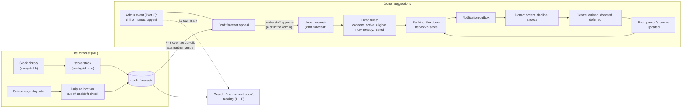

# Plan: the ML system, from the stock-out forecast to donor suggestions

**Status: PLAN, not started.** Nothing here is built. The design, settings and dates are proposals with reasons; every value marked *assumption* is set in simulation or shadow mode before anyone relies on it.

- Paths are relative to `bloodlink/` unless they start with `../`.
- **It builds on:**
  - `docs/SUMMARIES/ml_models.md`: the forecast, its decision rule, phases 5.3 to 5.5, and "How the prediction feeds the engine";
  - `../rough_work/ML/SUMMARY.md`: the interim model choice, the 19 inputs and the alert budget;
  - [`plan_donor_network.md`](plan_donor_network.md): consent, donor areas, `donor_status`, the matching score, waves, the notification outbox and shadow mode. This plan defines its "forecast appeal" request kind;
  - [`plan_panels.md`](plan_panels.md): F1 (organization members), F3 (a verified eRaktKosh link), F5 (the notifications inbox), F6 (two-factor sign-in) and F8 (the email sender), and the admin panel with `audit_log`.
- Medical and legal statements are a starting point for review by the project guide and a partner centre's medical officer, not advice.

**Contents**
1. [What it is](#what-it-is)
2. [Part A: the forecast in the app](#part-a-the-forecast-in-the-app)
3. [Part B: suggesting donors](#part-b-suggesting-donors)
4. [Who may be suggested: active, eligible now, nearby](#who-may-be-suggested-active-eligible-now-nearby)
5. [Ranking whom to ask: the donor network's score](#ranking-whom-to-ask-the-donor-networks-score)
6. [Part C: stock-out events an admin makes](#part-c-stock-out-events-an-admin-makes)
7. [Data model](#data-model)
8. [Privacy, safety and fairness](#privacy-safety-and-fairness)
9. [Measuring it](#measuring-it)
10. [Testing and simulation](#testing-and-simulation)
11. [Rollout, with dates](#rollout-with-dates)
12. [Decisions and alternatives](#decisions-and-alternatives)
13. [Risks](#risks)
14. [Open questions](#open-questions)
15. [Sources](#sources)

---

## What it is

One ML model, the stock-out forecast, and two ways the app acts on a shortage:

- **A. The forecast: where and when will blood run short?** After each 6-hourly grid time, the model the December backtest chooses scores every bank's red cells by blood group: the chance of a stock-out within 24, 48 and 72 hours. The interim choice is logistic regression, with the GBM classifier as the challenger. The scores are calibrated daily, watched for drift, and used behind flags: a "may run out soon" mark on search results, the (1 − P) factor in ranking, and Part B.
- **B. Donor suggestions: who is asked to help?** When a partner blood centre's group is likely to run out within 48 hours, bloodLink suggests to a few people nearby that they donate there. Each of them must:
  - have joined the network and opted in to suggestions;
  - have been active recently;
  - be eligible to donate today.

  Among those who pass, the donor network's score puts first the people most likely to come, from each person's own record of answering and turning up. It needs no training. Fixed rules that no score can override keep the ineligible, the tired and the far away out.
- **C. A stock-out event an admin makes.** An admin can mark a bank's group at risk by hand. A **drill** reaches only test accounts, for demonstrations and testing. A **manual appeal** reaches real people only after a partner centre approves it. Both run through Part B's rules and waves, and neither is ever labelled as the forecast.

Nothing rewards a person for donating: paid donation has been banned in India since 1998 (`plan_donor_network.md`, legal frame).



---

## Part A: the forecast in the app

### A1 · What is deployed

- **The model the December backtest picks** (report 3, phase 5.3). The interim choice is logistic regression on the 19 core inputs, one model per horizon (24, 48, 72 h), for packed red cells and all 8 groups. Other components follow once their history is checked the same way.
- **The inputs:**
  - units of the group, the bank's total red cells, groups stocked, the group's share;
  - past drops to zero per day seen over 7 days, and the change over 24 h and 72 h;
  - decreases and increases per day, days of supply and the bank's total use;
  - updates in 24 h, updates per day and hours since the last update;
  - auto-refresh, ownership, state, blood group and Rh negative.
- **Two of them aren't in the database yet.** Ownership is `blood_banks.hospital_type`. The auto-refresh list (eRaktKosh's `master/portal-refresh-hospitals`) is only in the laptop's archive. The weekly directory run in `src/lib/collector.js` saves it as `blood_banks.auto_refresh`: one more call a week, inside the collection limit.

### A2 · Train in Python, score in TypeScript

- **Training stays in Python,** where the walk-forward harness and its tests are. The scripts move from `../rough_work/ML/` (outside git) into the repository as `ml/`, so every deployed model can be rebuilt from versioned code:
  - `ml/dataset.py`: phase 5.1's dataset builder;
  - `ml/train.py` and `ml/export.py`;
  - their tests, and pinned requirements.
- **The artifact is a JSON file:**
  - for each horizon: each input's transform (log, signed log, dummy), mean, scale and coefficient;
  - the intercept and the starting Platt parameters;
  - the training dates, the backtest's metrics, and a SHA-256 of the file.

  It is stored in a private Storage bucket, `ml-models`, with a `model_versions` row.
- **Scoring is a dot product,** which is the deployment argument for logistic regression. It runs in a new Edge Function, `score-stock`, on the collector's pattern:
  - a `pg_cron` tick at each grid time, 00:05, 06:05, 12:05 and 18:05 India time;
  - a secret in Vault, and a limited role, `bloodlink_ml`;
  - a row per run in `forecast_runs`.
- **Two pure modules, tested with Vitest:** `src/lib/stockoutFeatures.js` builds the inputs from `stock_history` (kept 60 days) and `bank_stock_latest`, rebuilding stock at the banks' own update times on the 6-hourly grid, as training does. `src/lib/stockoutModel.js` applies the artifact.
- **Parity test, as for eligibility.** On fixtures of real history, the Python dataset builder and `stockoutFeatures.js` must give the same inputs, and the two scorers the same probabilities to 6 decimal places. The test runs in CI with #20's suite. A model whose parity test fails is never promoted.
- **If the GBM classifier wins in December:** scikit-learn's histogram trees export to no format a small JS scorer can read. ONNX through skl2onnx would need an ONNX runtime inside the Edge Function. So retrain with LightGBM using the same settings, export its JSON tree dump (`dump_model()`), and walk the trees in `stockoutModel.js`, about a hundred lines with the same parity test. The fallback is scoring in Python on a scheduled job.

### A3 · Each run

1. Read the last 8 days of `stock_history` and the latest stock for every bank that isn't dormant.
2. Build the inputs for every bank and group with stock above zero. That is about 20,000 rows, scored in seconds, well inside the Edge Function's 150 s.
3. Write `stock_forecasts`: the raw and calibrated P for each horizon, the model version and the grid time. Also store the three inputs pushing the risk up most, as coefficient × standardized value, for plain-language reasons ("dropped to zero twice this week", "few units left").
4. Record the run in `forecast_runs`. The admin overview shows the last one and turns red after 7 hours.

### A4 · Calibration, cut-off and drift, every day

- **Outcomes.** A daily job labels every grid time whose window has closed, by report 3's label rules: cleared pages and dormant banks are left out, and quick refills count. The labels go in `forecast_outcomes`.
- **Calibration.** Platt scaling on the latest day whose outcomes are all known (H/24 + 1 days back), as the walk forward tested. It is a two-parameter logistic fit, done in JS, with parity against scikit-learn.
- **The alert cut-off** is set on that same day to the score that gives 1 false alert per bank per week, counting at most one per bank, group and day. Tested, a cut-off set a day ahead gave 0.98 false alerts per bank per week.
- **Daily metrics** (`forecast_daily_metrics`): PR-AUC, mean prediction ÷ observed rate, false alerts per bank per week and recall at the cut-off, and lift by blood group.
- **Kill switch.** The forecast's flags turn off by themselves, and an admin is told, if any of these happens:
  - false alerts stay above 1.5 per bank per week for 3 days running;
  - the calibration ratio leaves 0.8 to 1.25;
  - a run fails twice.

  The thresholds are *assumptions*. Admin events (Part C) have their own flag, which the kill switch leaves alone: they don't depend on the model.

### A5 · Retraining and promotion

- **Monthly** (phase 5.5), on the laptop, from the synced archive (`npm run archive:sync`), with an expanding window.
- **Champion and challenger.** A new version scores in shadow next to the live one for a week, and is promoted only if it isn't worse by report 3's rule (2 points, 80% of resamples) on that week and passes the parity test. Each version gets a short model card in `ml/MODEL_CARDS.md` (Mitchell et al., 2019): the data, the metrics by group, the known weak spot (Rh− lift) and what changed.

### A6 · What the app does with it, each behind a flag in `feature_flags`

| Use | Detail | Gate |
|---|---|---|
| "May run out soon" | A mark on a bank in search when its P48 for the group asked passes the cut-off, with the reason and "forecast, informational" | 2 weeks of shadow (A7) |
| Ranking | Coverage and surplus × (1 − P24); a planned request uses P48 or P72 (report 3) | Point 4's sensitivity check, `scripts/ranking-sensitivity.mjs`, rerun with the factor |
| Donor suggestions | Part B | Its own phases |
| A public "donate here" list | Partner centres and groups at high risk within 72 h, on the donor page | After Part B's pilot |

### A7 · Shadow mode first

Report 3's phase 5.4: two weeks in which runs write scores and metrics but nothing is shown. **Exit:**
- live calibration ratio 0.8 to 1.25;
- false alerts at the carried cut-off at most 1.2 per bank per week;
- parity tests green;
- no failed runs for 7 days.

---

## Part B: suggesting donors

### B1 · A suggestion is a forecast appeal

- `plan_donor_network.md` already lists **"Forecast appeal (later)"** as a request kind (`blood_requests.kind = 'forecast'`, routine urgency). This plan defines it.
- **Only partner centres.** A forecast appeal is anchored to a verified blood-centre organization:
  - with its eRaktKosh code confirmed (panels F3);
  - that has turned on `accepts_forecast_appeals`.

  Most eRaktKosh banks aren't on bloodLink; their risk shows in search (A6) but sends nobody to them.
- **The centre approves each appeal at first.** When the forecast flags one of its groups, its panel shows a draft: the group, P48 with its reasons, and a suggested number of donors and a window. Staff approve, edit or dismiss it. Dismissals and their reason ("we have a camp tomorrow", "stock is fine") are kept: they are feedback on the forecast. Auto-approval is a later option the centre can choose.
- **The message,** in-app, push and email, never SMS for a routine appeal:
  > **bloodLink: B− donors may be needed soon** at KEM Hospital Blood Centre, Parel, about 4 km from you. You may be eligible to donate; the centre decides. Can you come by Friday? Reply in the app. bloodLink never asks for money.

### B2 · The flow

1. **A forecast run** marks (bank, group) pairs whose P48 passes the cut-off. For a partner centre, it drafts an appeal, at most one per centre and group in 7 days.
2. **Staff approve it,** creating the request through `create_request()`.
3. **Matching,** each wave:
   1. the fixed rules (below);
   2. the ranking, by the donor network's score (below);
   3. the top k, with the donor network's wave sizing and routine settings: first wave in the next 09:00 to 20:00 window, 4 hours between waves, at most 3 waves of 25, overbooking 1.3;
   4. rows in `request_responses` and the outbox, and one row per person asked in `suggestion_decisions`, with the score and its parts.
4. **The donor** sees the card with its reason. Before accepting, they confirm a short checklist: "Since you last told us: no tattoo or piercing, not pregnant or breastfeeding, no new medicine, feeling well". Then they accept, decline or snooze, and book a slot or walk-in window.
5. **The centre** marks arrived, then donated or deferred, with no reason stored, through the donor network's `check_in()` and `confirm_donation()`. The counts behind each person's score update as the donor network's do, when they answer and when they are checked in.
6. **Once an appeal's window and two days have passed,** each person's outcome goes into `suggestion_outcomes`, for the measures below.

### B3 · Why the forecast and the suggestions need each other

- The forecast says **where and when** blood will be short; the suggestions decide **who** is asked. Neither is enough alone: a good forecast with poorly chosen asks wears donors out, and good asks without a forecast arrive after the shortage.
- **The forecast changes what it predicts.** An appeal that brings donors can prevent the stock-out it forecast, a known effect of predictions that drive decisions (Perdomo et al., 2020). So:
  - every series that had an approved appeal is marked in `forecast_outcomes` for the appeal's window plus 72 h;
  - training and the daily metrics either leave those cases out or report them apart, so the forecast doesn't learn that flagged banks never run out;
  - the score counts whether the asked person came, not whether the stock-out was avoided, which would mix the two effects.

---

## Who may be suggested: active, eligible now, nearby

Every rule must hold before anyone is ranked. No score can override them, and they run again just before a message is sent and when the donor accepts.

| # | Rule | How it is checked | Source |
|---|---|---|---|
| 1 | **In the network, and opted in to suggestions:** consents for `donor_network` and `forecast_suggestions` given and not withdrawn; not suspended | `consents`, `profiles.is_suspended` | Donor network; S10 below |
| 2 | **Active:** signed in within 30 days, or answered a request within 60 days; available and not snoozed (*assumption*) | `auth.users.last_sign_in_at` read by the matching function; `request_responses`; `donor_settings` | — |
| 3 | **Eligible today:** `donor_status.eligible_from <= today`, by India's date | Trigger-maintained, never client-set | `eligibility.js` rules, SQL copy and parity test (donor network) |
| 4 | **No staff check pending:** status `eligible`, not `review`. Current medication needs a centre's check first | `donor_status.needs_staff_check = false` | `evaluateEligibility` |
| 5 | **Screening answers confirmed within 90 days** (*assumption*). The answers are yes-or-no for windows of 6 to 12 months and carry no dates, so an old "no" may no longer be true. Without a recent confirmation, the person gets "Please check your answers" instead of a suggestion | `donor_status.screening_confirmed_at` | NBTC clauses 15 to 17 and 47 |
| 6 | **Age on the day,** from date of birth: 18 to 65, and 60 or under for a first donation | Computed at query time, since birthdays move it | NBTC clause 2 |
| 7 | **Exact group only,** including Bombay | `donor_status.blood_group_code` | Report 3's D1.4 |
| 8 | **Nearby:** a donor area within the centre's first two rings (urban 5 and 10 km, rural 20 and 50 km), and at most 45 minutes by the straight-line travel estimate (*assumption*) | `ST_DWithin` on `donor_areas`; `src/lib/traffic.js`'s estimate. No donor position leaves the database | Donor network |
| 9 | **Rested:** no request of any kind in the last 7 days, at most one suggestion in 14 days, under the weekly cap, outside quiet hours, and not on hold for a critical request (*assumption*) | `donor_status`, `donor_settings` | Donor network's "Protecting donors", made stricter for routine appeals |
| 10 | Not already asked for this appeal; not a member of the raising centre | `unique (request_id, donor_id)` | Donor network |

**What "eligible" means to the donor.** Every card says "you may be eligible; the blood centre decides". Only the centre's medical officer says "you can donate today" (NBTC 2017). A deferral at screening never counts against the person (the score, below). A centre may record "deferred until" a date, with no reason, which moves `eligible_from`.

---

## Ranking whom to ask: the donor network's score

- **The score** is the donor network's, with its routine setting: p_donate × e^(−minutes / 60) × rested.
  - p_donate = respond × show, from each person's own counts of asks, accepts and arrivals. The counts are smoothed so that one "no" doesn't write anyone off: a new donor starts at 0.2 to respond × 0.8 to show (*assumptions*, set in simulation).
  - The counts update with every answer and every check-in, so the score learns each person's record without a trained model.
  - `rested` lowers the score of people asked recently, and ties are broken at random, so equal people share the load.
- **What counts as showing up:** arriving at the centre within the appeal's window, whether the person then donates or is deferred at screening. They did everything asked of them, and a screening outcome never lowers anyone's score (the donor network's rule).
- **What it uses:** travel minutes, the person's own counts, and days since they were last asked. **Never** gender, age, health answers, religion, caste, income or exact location. Eligibility rules that depend on them act only as filters.
- **Why no trained model of who comes** (S7):
  - At the pilot's size (100 donors in one city, donor network), the rules leave fewer people for most appeals than one wave of 25 asks. Everyone who passes is asked, and the order changes nothing.
  - The counts above already learn from each outcome.
  - A trained model would need about 500 suggestions with arrivals recorded by centre staff, months at one centre, and its own retraining, model card and parity test.

---

## Part C: stock-out events an admin makes

An admin can mark a bank's group at risk by hand, on a new page, `/admin/events`. They pick:
- the bank;
- the blood group and component, red cells by default;
- a window of 24, 48 or 72 hours;
- a reason, which is required;
- one of two modes.

The event then runs through the forecast's path, from the "may run out soon" mark to the waves, under every fixed rule.

| Mode | For | Where | Who sees the mark | Who is prompted | Approved by |
|---|---|---|---|---|---|
| **Drill** | Showing the panel the whole flow, training centre staff, and testing it end to end before the forecast or the donors are real | Any bank | Admins and test accounts | Test accounts only, by the same rules and score | The admin who made it |
| **Manual appeal** | A shortage the forecast missed that an admin knows of, such as a cancelled camp or a dengue surge nearby | A partner centre that accepts forecast appeals (B1) | Everyone | Real people, by every rule and the score, as a routine appeal | The centre's staff, as for a forecast draft |

- **Never shown as the forecast.**
  - A manual appeal's mark and card say "flagged by bloodLink's team".
  - A drill's mark, card and every message start "Drill: no blood is needed".
- **No made-up shortage reaches real people without the centre's approval** (S12). An admin isn't at the centre and can't see its stock, and people sent to a centre that didn't ask are a harm (S5). At a bank that isn't a partner, an admin can only run a drill.
- **The flow:**
  - **A drill** becomes a `blood_requests` row with `is_drill`, anchored to the bank's eRaktKosh code, with no centre to approve it.
  - **A manual appeal** becomes a draft in the centre's panel, marked as an admin's with its reason. Staff approve, edit or dismiss it, as for the forecast's drafts.
  - **Before saving,** the page shows how many people pass the rules, as a number only.
- **Test accounts** are ordinary accounts that a script marks `profiles.is_test_account`: `npm run db:make-tester -- <email>`, like `db:make-admin`. Being test accounts isn't something people choose.
  - A drill matches only test accounts, and a real request never matches one.
  - They join the network, set a donor area near the bank and answer the screening questions like anyone else, so a drill also tests the rules.
- **The forecast's limits apply.** A manual appeal counts towards the one appeal per centre and group in 7 days, shared with the model's drafts, and towards the rest rules. Drills only reach test accounts, so they never use up a real person's rest.
- **Kept apart in the data.**
  - Events are stored in `admin_stock_events`, never in `stock_forecasts`, so they never enter calibration, the cut-off or the forecast's metrics.
  - A manual appeal still marks its series `had_appeal` (B3), because it changes the outcome in the same way.
  - Drills and test accounts are left out of every measure.
- **Who sees the mark** is decided in the database. Search reads `visible_stock_events()`, which shows a drill only to admins and test accounts, and a manual appeal to everyone once the centre approves it.
- **Guarded and recorded.**
  - Only admins with two-factor sign-in (panels F6) can create or end an event, through `create_admin_event()` and `end_admin_event()`. Each writes `audit_log`.
  - Ending an event removes the mark and stops new waves. A manual appeal ends through the donor network's `cancel_request()`, so everyone with an open response is told at once.
- **Its own flag,** `admin_events`, off until phase 2.

---

## Data model

Sketches, in the style of `plan_donor_network.md`. Each becomes a timestamped migration sorting after `20261103000100`, with explicit grants and CHECK constraints mirrored in JS validators.

```sql
-- Part A
alter table public.blood_banks add column auto_refresh boolean;     -- from the weekly directory run

create table public.feature_flags (
  name text primary key
    check (name in ('forecast_badge', 'forecast_ranking', 'forecast_appeals', 'admin_events')),
  is_enabled boolean not null default false,
  disabled_reason text,                          -- set by the kill switch
  updated_by uuid references public.profiles (id) on delete set null,
  updated_at timestamptz not null default now()
);

create table public.model_versions (
  id text primary key,                           -- for example 'stockout-logit-2027-01-04'
  kind text not null check (kind in ('logistic', 'gbm')),
  artifact_path text not null,                   -- in the private 'ml-models' bucket
  artifact_sha256 text not null,
  trained_from date not null,
  trained_to date not null,
  evaluation jsonb not null,                     -- the promotion rule's metrics, by horizon and group
  status text not null check (status in ('shadow', 'live', 'retired')),
  created_at timestamptz not null default now()
);

create table public.stock_forecasts (
  hospital_code text not null,
  component_id text not null,
  blood_group_code text not null,
  as_of timestamptz not null,                    -- the grid time
  model_version text not null references public.model_versions (id),
  p_raw real[] not null,                         -- 24, 48, 72 h
  p real[] not null,                             -- calibrated
  reasons jsonb not null,                        -- the top three inputs, in words
  primary key (hospital_code, component_id, blood_group_code, as_of, model_version)
);

create table public.forecast_outcomes (          -- written a day or more later
  hospital_code text not null,
  component_id text not null,
  blood_group_code text not null,
  as_of timestamptz not null,
  stockout boolean[] not null,                   -- 24, 48, 72 h; null where left out by the label rules
  had_appeal boolean not null default false,     -- B3: report apart
  primary key (hospital_code, component_id, blood_group_code, as_of)
);

create table public.forecast_runs (              -- one row per run, as collector_runs
  id bigint generated always as identity primary key,
  as_of timestamptz not null,
  model_version text references public.model_versions (id),
  started_at timestamptz not null default now(),
  finished_at timestamptz,
  rows_scored integer,
  error text
);

create table public.forecast_daily_metrics (     -- A4; read by the admin overview
  day date not null,
  horizon_h smallint not null check (horizon_h in (24, 48, 72)),
  model_version text not null references public.model_versions (id),
  pr_auc real,
  calibration_ratio real,                        -- mean prediction ÷ observed rate
  cut_off real,
  recall_at_cut_off real,
  false_alerts_per_bank_week real,
  lift_by_group jsonb,
  primary key (day, horizon_h, model_version)
);

-- Part B
alter table public.organizations add column accepts_forecast_appeals boolean not null default false;
alter table public.donor_status add column screening_confirmed_at date;   -- set by the screening trigger
-- consents.purpose gains 'forecast_suggestions'

create table public.forecast_appeal_drafts (
  id bigint generated always as identity primary key,
  organization_id uuid not null references public.organizations (id) on delete cascade,
  blood_group_code text not null,
  component_id text not null,
  source text not null default 'model' check (source in ('model', 'admin')),
  p48 real,                                      -- the model's; null for an admin's draft
  suggested_donors smallint not null,
  status text not null default 'pending' check (status in ('pending', 'approved', 'dismissed', 'expired')),
  dismissed_reason text check (char_length(dismissed_reason) <= 200),
  request_id uuid references public.blood_requests (id) on delete set null,
  created_at timestamptz not null default now(),
  check (source = 'admin' or p48 is not null)
);

create table public.suggestion_decisions (
  id bigint generated always as identity primary key,
  request_id uuid not null references public.blood_requests (id) on delete cascade,
  donor_id uuid not null references public.profiles (id) on delete cascade,
  wave smallint not null,
  inputs jsonb not null,                         -- the score's parts: counts, travel band, rested
  score real not null,
  created_at timestamptz not null default now()
);

create table public.suggestion_outcomes (
  decision_id bigint primary key references public.suggestion_decisions (id) on delete cascade,
  arrived boolean not null,
  donated boolean not null,
  opted_out_within_7d boolean not null,
  finalised_at timestamptz not null default now()
);

-- Part C
alter table public.profiles add column is_test_account boolean not null default false;  -- no column grant: set by db:make-tester only
alter table public.blood_requests add column is_drill boolean not null default false;
-- blood_requests.organization_id may be null only for a drill:
--   check (organization_id is not null or is_drill)

create table public.admin_stock_events (
  id bigint generated always as identity primary key,
  mode text not null check (mode in ('drill', 'manual_appeal')),
  hospital_code text not null,                   -- the eRaktKosh bank marked at risk
  organization_id uuid references public.organizations (id) on delete cascade,  -- the partner centre
  component_id text not null,
  blood_group_code text not null,
  window_hours smallint not null check (window_hours in (24, 48, 72)),
  reason text not null check (char_length(reason) between 10 and 200),
  status text not null default 'active'
    check (status in ('awaiting_centre', 'active', 'dismissed', 'ended', 'expired')),
  draft_id bigint references public.forecast_appeal_drafts (id) on delete set null,  -- a manual appeal's
  request_id uuid references public.blood_requests (id) on delete set null,
  created_by uuid references public.profiles (id) on delete set null,
  created_at timestamptz not null default now(),
  ends_at timestamptz not null,
  ended_by uuid references public.profiles (id) on delete set null,
  check (mode = 'drill' or organization_id is not null)
);
```

**Who can read and write what**

| Table | Donor | Centre members | Admins | Functions and roles |
|---|---|---|---|---|
| `stock_forecasts` | The mark and reasons only, through search | Their own banks', in full | All | Written by `bloodlink_ml` |
| `forecast_outcomes`, `forecast_runs`, `forecast_daily_metrics`, `model_versions` | — | — | Read | Written by `bloodlink_ml` |
| `feature_flags` | — | — | Read and write | The kill switch, as `bloodlink_ml` |
| `forecast_appeal_drafts` | — | Their organization's: read, approve, dismiss | Read | Created by `bloodlink_ml` or `create_admin_event()`; approved through `approve_forecast_appeal()` |
| `suggestion_decisions`, `suggestion_outcomes` | Their own, through `my_suggestions()`, as plain reasons, not raw inputs | — | Aggregates only | Written by the matching function and the outcome job |
| `admin_stock_events` | The mark, through `visible_stock_events()`: a drill's only for test accounts | Their organization's manual appeals, as drafts | Create, read and end, with two-factor | `create_admin_event()` and `end_admin_event()`, both writing `audit_log` |
| `profiles.is_test_account` | — | — | Read | Set only by `npm run db:make-tester` |

---

## Privacy, safety and fairness

| Concern | Design |
|---|---|
| **Consent** | Suggestions are a different purpose from answering a shortfall, so they get their own opt-in (`forecast_suggestions`), with a notice on `/privacy` and a new `PRIVACY_VERSION` (DPDP Act, 2023). Withdrawing it stops suggestions at once and keeps the person's other choices |
| **Location** | The donor network's 1 km cells only. Travel is estimated in the database, never by sending a position to OSRM or anyone else |
| **Health data** | The score never sees screening answers. It sees only that rules 3 to 6 passed. `donor_screening` stays owner-only |
| **Why was I asked?** | Each card gives the reason ("B− is likely to run short at this centre; you're about 4 km away and have donated before"), and `my_suggestions()` lists every suggestion with its reason. Nothing is decided by an input the person can't see described |
| **Fairness** | No protected or sensitive attribute is an input to the score. The smoothed counts give new donors a fair start, `rested` and random tie-breaks spread asks, and the share of asks taken by the most-asked 10% is watched (below) |
| **Fatigue** | Rule 9's rest rules, at most 3 waves, opt-outs watched (below), and automatic snoozing after three ignored requests (donor network) |
| **Wrong forecasts** | The centre approves each appeal at first, and the kill switch (A4) stops drafts when the forecast drifts |
| **Admin events** | Drills reach only test accounts, and real requests never reach them. A manual appeal reaches real people only after the centre approves it, and says it was flagged by bloodLink's team. Every event is audited and can be ended at once (Part C) |
| **Money and pressure** | Every message says bloodLink never asks for money. Appeals are voluntary donations to the centre's stock, never for a named patient (NBTC: replacement donation is to be phased out) |
| **Retention** (*assumption*) | `suggestion_decisions` and `suggestion_outcomes` 12 months, then reduced to monthly counts. Forecasts 60 days, as `stock_history`, with the archive in Storage for evaluation. `admin_stock_events` as `audit_log` |
| **Deletion** | Every new foreign key to `profiles` cascades or sets null, so `delete_my_account()` is never blocked |

---

## Measuring it

| Measure | Definition | Target (*assumption*) |
|---|---|---|
| **Forecast, live** | PR-AUC at 48 h, mean prediction ÷ observed rate, false alerts per bank per week at the cut-off, lift by group | Calibration 0.8 to 1.25; false alerts ≤ 1.2 |
| **Draft precision** | The model's approved drafts ÷ its drafts; dismissals by reason | ≥ 50%, or the cut-off is raised |
| **Arrivals per suggestion** | Arrived ÷ suggested, for the forecast's appeals and admins' apart, against the score's mean p_donate | Mean p_donate ÷ arrival rate between 0.8 and 1.25, or the starting counts are reset |
| **Fill rate** | Arrivals ÷ donors the approved appeal asked for | ≥ 50% for routine appeals |
| **Suggestions per unit** | Suggested ÷ donated | ≤ 12 |
| **Fatigue** | Opt-outs or long snoozes within 7 days of a suggestion ÷ people suggested | ≤ 2% |
| **Fairness** | Share of suggestions taken by the most-asked 10% of eligible donors | ≤ 25% |
| **Eligibility safety** | People suggested who weren't eligible that day, found on any later check | 0 |

They appear on the admin overview, next to the collector's card, and in the centre's panel for its own appeals. Drills and test accounts are left out of all of them.

---

## Testing and simulation

| Level | What | How |
|---|---|---|
| **Unit** | Input building, the scorer, Platt fitting, the cut-off, the kill switch; each fixed rule at its edges (eligible today and tomorrow, birthdays at 18, 60 and 65, a confirmation 89 and 91 days old, quiet hours in India time); the donor network's score; outcome labelling; an admin event's checks (a manual appeal only at a partner centre, a reason required, the 7-day limit shared with the model's drafts) | Vitest, on pure modules: `stockoutFeatures.js`, `stockoutModel.js`, `donorRanking.js`, `adminEvents.js` |
| **Parity** | Python and JS inputs and probabilities for the forecast; Platt against scikit-learn; eligibility SQL against `evaluateEligibility` (donor network) | Fixtures of real history; CI (#20) |
| **Row-level security** | Every row of the access table, as each role; a drill never reaches anyone who isn't a test account, and a real request never reaches a test account; a non-admin, or an admin without two-factor, can't create an event | supabase-js against local Supabase, never production |
| **Simulation** | Synthetic donors around real bank points, with behaviour from the UCI donor data's recency and frequency (donor network). It compares random asks with the donor network's score on arrivals per suggestion, opt-outs and fairness, and sets the score's starting counts and the wave sizes | `ml/simulate_suggestions.py`; its outputs are labelled guesses until shadow mode replaces them |
| **Shadow** | Forecast (A7); then suggestions: drafts, approvals and matching run, and whom it would ask is logged, but no message is sent | 2 weeks each |
| **End to end** | Flag on → draft → approve → wave → accept with the checklist → arrived → outcome, started once by the forecast and once by an admin's drill | Playwright on a local stack |
| **Demonstration** | An admin's drill at a chosen bank: the mark, the prompts to test accounts, accepting and checking in | Test accounts on the deployed app; nothing reaches real people |

---

## Rollout, with dates

| Phase | When | Contents | Exit |
|---|---|---|---|
| **0 · Groundwork** | November to December 2026, beside report 3's phases 5.1 and 5.2 | `ml/` in the repository with the dataset builder; `blood_banks.auto_refresh`; the Part A tables and flags; `stockoutFeatures.js` and the parity test on today's interim model | Parity green on a week of real history |
| **1 · The model chosen** | Late December 2026 | Report 3's backtest (phase 5.3) picks the model; export; parity on the chosen model | A `model_versions` row in `shadow` |
| **2 · Forecast in shadow** | January 2027, 2 weeks (report 3's phase 5.4) | `score-stock` at each grid time; daily outcomes, calibration, cut-off and metrics; nothing shown. `/admin/events` with drills of the mark, seen only by admins and test accounts | A7's exit |
| **3 · Forecast shown** | February 2027 | The mark, then the ranking factor after the sensitivity check; monthly retraining starts | 4 weeks without a kill-switch stop |
| **4 · Suggestions in shadow** | With the donor network's phase 2 | A partner centre with `accepts_forecast_appeals`; drafts and approvals; matching with the donor network's score, logged, not sent. Drills prompt test accounts end to end | 2 weeks; the centre's staff find the drafts and choices sensible; simulation settings chosen |
| **5 · Suggestions live** | With the donor network's phase 3, one centre | In-app, push and email; daytime only; manual appeals at the partner centre | 30 appeals closed with outcomes; no eligibility or safety incident; fatigue ≤ 2% |
| **Later** | 2027 | Auto-approval for centres that want it; whole blood and platelets; the public list | — |

**Needs:**
- from the donor network: phases 0 to 3, with consent, `donor_areas`, `donor_status` and its eligibility parity test, the outbox, and shadow mode;
- from the panels plan: F1, F3, F5, F6 and F8;
- a partner blood centre whose medical officer reviews the checklist and the message copy;
- the project guide's sign-off on proactive suggestions under the DPDP Act.

---

## Decisions and alternatives

**S1 · Train in Python, score in TypeScript from an exported artifact.**
- *Why:* training keeps the tested harness; scoring runs where the data is, on the collector's proven pattern, with no new runtime to host.
- *Alternatives:* a Python service on a host or a scheduled GitHub Action (another runtime and secret to keep); scoring in SQL (input code in SQL is hard to test, and the trees would be worse).

**S2 · Score at the 6-hourly grid times, not after each sweep.**
- *Why:* the model was trained and tested on that grid, at those hours. Scoring at other times would score cases unlike its training data.

**S3 · Deploy the backtest's winner, as report 3's rule decides.** Logistic regression is expected and is the easiest to deploy and explain. If the GBM classifier wins, LightGBM's tree dump is walked in JS (A2).

**S4 · Calibrate and set the cut-off daily, with a kill switch.**
- *Why:* the walk forward showed calibration drifts (the logistic models over-predicted by 25%) and that a cut-off set a day ahead holds.
- *Alternative:* fixed values from the backtest, which go stale as the history grows and festivals arrive.

**S5 · Suggestions only through partner centres that opt in and approve each appeal.**
- *Why:* every request must be anchored to a licensed centre (donor network, N1), and an unannounced crowd at a centre that didn't ask is a harm. Approval also catches forecast errors before they reach donors.
- *Alternative:* suggest any eRaktKosh bank at risk. Wider reach, but no one accountable receives the donors.

**S6 · Fixed rules before any score; "eligible now" checked three times.**
- *Why:* safety and the law aren't things for a score to weigh. Eligibility is checked when candidates are chosen, before sending and on acceptance, because days pass between the three and birthdays and gaps move.

**S7 · One trained model, the forecast; the donor network's score ranks donors.**
- *Why:*
  - the stock history covers about 30,000 series every 4.5 hours, and the forecast is tested on it. Who comes depends on people bloodLink hasn't asked yet, so there is nothing to train on;
  - at the pilot's size, most appeals have fewer people who pass the rules than one wave asks, so the order rarely matters;
  - the score's smoothed counts already learn each person's record.
- *Alternatives:*
  - a logistic regression of who arrives (report 3's donor-response model), worth revisiting if appeals often have more people who pass the rules than one wave asks;
  - a contextual bandit, such as Thompson sampling (Li et al., 2010; Chapelle and Li, 2011), which is harder to explain to the panel and to audit.

**S8 · Count arriving, not donating, and use nothing sensitive.**
- *Why:* arriving is what the person controls. Counting a deferral as arriving keeps screening outcomes from lowering anyone's score. Leaving sensitive attributes out keeps the ranking from acting on patterns that would be unfair or unlawful.

**S9 · Record how each person was chosen.**
- *Why:* each suggestion keeps the score and its parts, so "why was I asked?" always has an answer, and the starting counts can be checked against arrivals.

**S10 · A separate consent for suggestions.**
- *Why:* being asked proactively, from a forecast, is a different use of a person's data from answering a shortfall. The DPDP Act asks for specific consent per purpose.

**S11 · Mark appealed series in the forecast's data.**
- *Why:* appeals change the outcome the forecast predicts (B3). Without the mark, retraining would learn that flagged banks don't run out.

**S12 · An admin's event is a drill unless a partner centre approves it.**
- *Why:*
  - a made-up shortage shown to real people at a bank that didn't ask is false information about a real centre, and sends people who aren't needed (S5);
  - drills let the panel see the whole flow, and staff practise it, before the forecast or the donors are real, without waiting for a real stock-out.
- *Alternatives:*
  - letting admins prompt real people at any bank, which S5 rules out;
  - no admin events, which leaves demonstrations and end-to-end checks waiting for a real forecast.

---

## Risks

| Risk | Effect | Mitigation |
|---|---|---|
| **The forecast is wrong too often** | Donors asked for nothing; centres stop approving | The centre's approval; the alert budget; the kill switch; draft precision watched |
| **Self-defeating forecasts** | Retraining learns flagged banks are safe | S11's mark; report appealed cases apart |
| **The score's starting counts are wrong** | Waves too big or too small | Set in simulation, checked against arrivals (Measuring it); the counts update with every answer |
| **Stale eligibility** | Someone travels and is turned away, or someone unsafe is asked | Rules 3 to 6 and the three checks; the checklist on acceptance; "the centre decides" |
| **Python and JS disagree** | Wrong scores in production | Parity tests gate every promotion |
| **Drift with festivals, monsoon, dengue** | Calibration and false alerts move | Daily calibration, monthly retraining, the kill switch |
| **An admin's event taken for a real shortage** | People travel for nothing, or trust in the mark falls | Drills reach only test accounts and say "Drill"; a manual appeal needs the centre's approval and says who flagged it; every event is audited and can be ended at once |
| **Too few partner centres or donors** | Appeals reach no one | One city first; recruit through the centre's own donors and college NSS and NCC units (donor network) |
| **Explaining it to the panel** | A "black box" objection | Logistic regression for the forecast and a formula for the score, with reasons per bank and per person; the versions and evaluations on record; a drill to show the flow |

---

## Open questions

1. Should a centre be able to auto-approve drafts above a high P48, or always review them?
2. What counts as "active": 30 days since sign-in, or any answer in 60 days, or both?
3. Is 90 days right for re-confirming screening answers, given that the windows are 6 to 12 months?
4. Should the public "donate here" list include banks that aren't partners, with "call first"?
5. Which component comes after red cells: platelets in dengue season, or whole blood?
6. Once partner centres raise their own appeals (donor network), is an admin's manual appeal still needed, or only drills?

---

## Sources

- `docs/SUMMARIES/ml_models.md` and `../rough_work/ML/SUMMARY.md`: the forecast, its inputs, the alert budget, calibration and the interim choice.
- [`plan_donor_network.md`](plan_donor_network.md): the legal and clinical frame, matching, the score, waves, the outbox, eligibility in the database, and the UCI-based simulation this plan extends. [`plan_panels.md`](plan_panels.md): F1, F3, F5, F6, F8 and the admin panel.
- `src/lib/eligibility.js`: NBTC's 2017 donor-selection thresholds, clauses 2 to 4, 15 to 17 and 47; NBTC, *Guidelines for Blood Donor Selection & Blood Donor Referral*, 2017, as cited in the donor network plan.
- Perdomo, J., Zrnic, T., Mendler-Dünner, C. and Hardt, M. (2020). Performative prediction. *ICML*, PMLR 119, 7599–7609. [PMLR](https://proceedings.mlr.press/v119/perdomo20a.html).
- Mitchell, M. et al. (2019). Model cards for model reporting. *FAT\* '19*, 220–229. [arXiv:1810.03993](https://arxiv.org/abs/1810.03993).
- Platt, J. (1999). Probabilistic outputs for support vector machines and comparisons to regularized likelihood methods. In *Advances in Large Margin Classifiers*, MIT Press.
- The alternative in S7: Li, L., Chu, W., Langford, J. and Schapire, R. E. (2010). A contextual-bandit approach to personalized news article recommendation. *WWW*, 661–670. [arXiv:1003.0146](https://arxiv.org/abs/1003.0146). Chapelle, O. and Li, L. (2011). An empirical evaluation of Thompson sampling. *NeurIPS* 24. [Proceedings](https://papers.nips.cc/paper/2011/hash/e53a0a2978c28872a4505bdb51db06dc-Abstract.html).
