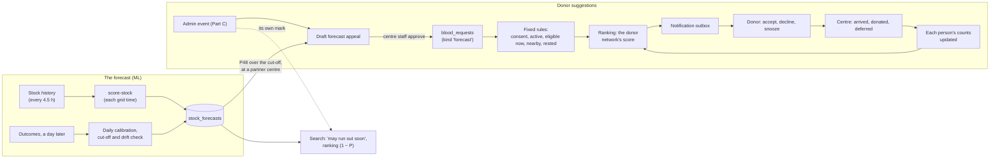

# Plan: the ML system, from the stock-out forecast to donor suggestions

**Status: Part A is built for the closed beta, 4 November 2026** (see [Part A in the beta](#part-a-in-the-beta)). The live model is logistic regression, predicting low stock: 2 units or fewer of a red-cell group within 24, 48 or 72 hours. It is live in the beta since 4 November. Part B runs in a simpler, in-app form (B0) and Part C as real admin events; both are built and go live once `20261105000200_admin_events.sql` is applied. The full Part B waits for the donor network. The design, settings and dates are proposals with reasons; every value marked *assumption* is set in the beta before anyone relies on it.

- Paths are relative to `bloodlink/` unless they start with `../`.
- **It builds on:**
  - `docs/SUMMARIES/ml_models.md`: the forecast, its decision rule, phases 5.3 to 5.5, and "How the prediction feeds the engine";
  - `../rough_work/ML-comparison/SUMMARY.md`: the interim model choice, the 19 inputs and the alert budget;
  - [`plan_donor_network.md`](plan_donor_network.md): consent, donor areas, `donor_status`, the matching score, waves, the notification outbox and shadow mode. This plan defines its "forecast appeal" request kind;
  - [`plan_panels.md`](plan_panels.md): F1 (organization members), F3 (a verified eRaktKosh link), F5 (the notifications inbox), F6 (two-factor sign-in) and F8 (the email sender), and the admin panel with `audit_log`.
- Medical and legal statements are a starting point for review by the project guide and a partner centre's medical officer, not advice.

**Contents**
1. [What it is](#what-it-is)
2. [Part A: the forecast in the app](#part-a-the-forecast-in-the-app)
3. [Part B: suggesting donors](#part-b-suggesting-donors)
4. [Who may be suggested: active, eligible now, nearby](#who-may-be-suggested-active-eligible-now-nearby)
5. [Ranking whom to ask: the donor network's score](#ranking-whom-to-ask-the-donor-networks-score)
6. [Part C: stock-out events an admin makes](#part-c-stock-out-events-an-admin-makes)
7. [Data model](#data-model)
8. [Privacy, safety and fairness](#privacy-safety-and-fairness)
9. [Measuring it](#measuring-it)
10. [Testing and simulation](#testing-and-simulation)
11. [Rollout, with dates](#rollout-with-dates), and [Part A in the beta](#part-a-in-the-beta)
12. [Decisions and alternatives](#decisions-and-alternatives)
13. [Risks](#risks)
14. [Open questions](#open-questions)
15. [Sources](#sources)

---

## What it is

One ML model, the stock-out forecast, and two ways the app acts on a shortage:

- **A. The forecast: where and when will blood run short?** After each 6-hourly grid time, the model the December backtest chooses scores every bank's red cells by blood group: the chance of a stock-out within 24, 48 and 72 hours. The interim choice is logistic regression, with the GBM classifier as the challenger. The scores are calibrated daily, watched for drift, and used behind flags: a "may run out soon" mark on search results, the (1 − P) factor in ranking, and Part B.
- **B. Donor suggestions: who is asked to help?** In the closed beta a simpler form runs (B0): eligible donors nearby see, in the app, the banks where their group may run low. Once the donor network exists: when a partner blood centre's group is likely to run out within 48 hours, bloodLink suggests to a few people nearby that they donate there. Each of them must:
  - have joined the network and opted in to suggestions;
  - have been active recently;
  - be eligible to donate today.

  Among those who pass, the donor network's score puts first the people most likely to come, from each person's own record of answering and turning up. It needs no training. Fixed rules that no score can override keep the ineligible, the tired and the far away out.
- **C. A stock-out event an admin makes.** An admin marks a bank's group at risk by hand, for 24, 48 or 72 hours. In the closed beta the event is real: search shows the bank "flagged by bloodLink's team", and eligible donors nearby see it in their suggestions. It ends by itself, or earlier when an admin ends it, and is never labelled as the forecast.

Nothing rewards a person for donating: paid donation has been banned in India since 1998 (`plan_donor_network.md`, legal frame).



---

## Part A: the forecast in the app

### A1 · What is deployed

- **Logistic regression,** adopted on 4 November 2026: the 19 core inputs, one model per horizon (24, 48, 72 h), for packed red cells and all 8 groups. Another model, such as the GBM classifier, can replace it later through `model_versions` if an independent comparison on more history shows it does better (A5). Other components follow once their history is checked the same way.
- **What it predicts: low stock.** The chance that a group's units fall to the threshold or fewer within the horizon, given more than the threshold now. The threshold is **2 units**, recorded in the artifact as `thresholdUnits`; 0 would be a stock-out. A bank already at or below it isn't forecast: search shows it as low now. The threshold was chosen on 4 November by walking forward on the history at 48 h:

  | Threshold | Cases forecast | Rate | PR-AUC, and over the best baseline | Caught at 1 false alert per bank per week | Carried cut-off: false alerts, caught |
  |---|---|---|---|---|---|
  | 0 (stock-out) | 100% | 5.9% | 0.251, +36% | 15.2% | 0.97, 15.2% |
  | 1 | 83% | 7.2% | 0.313, +26% | 18.7% | 1.07, 20.2% |
  | **2** | 72% | 7.7% | **0.348, +50%** | **22.6%** | **0.96, 23.0%** |
  | 3 | 64% | 7.9% | 0.364, +33% | 26.3% | 1.00, 27.2% |
  | 5 | 53% | 8.4% | 0.392, +68% | 30.7% | 0.93, 31.4% |

  A higher threshold warns of more falls within the alert budget, but forecasts fewer cases, and few of the Rh− groups, since most banks hold 1 to 3 units of those (22% of the cases at 2, 12% at 5). Retraining with another threshold is one argument to `ml/train.py`.
- **The inputs:**
  - units of the group, the bank's total red cells, groups stocked, the group's share;
  - past drops to zero per day seen over 7 days, and the change over 24 h and 72 h;
  - decreases and increases per day, days of supply and the bank's total use;
  - updates in 24 h, updates per day and hours since the last update;
  - auto-refresh, ownership, state, blood group and Rh negative.
- **Ownership** is `blood_banks.hospital_type`. **Auto-refresh** is `blood_banks.auto_refresh`, which the weekly directory run in `src/lib/collector.js` fills from eRaktKosh's `master/portal-refresh-hospitals`: one more call a week, inside the collection limit. Until the first weekly run after the migration, every bank reads as not auto-refreshed.

### A2 · Train in Python, score in TypeScript

- **Training stays in Python, in `ml/`,** so every deployed model can be rebuilt from versioned code:
  - `ml/dataset.py`: phase 5.1's dataset builder, the twin of `stockoutFeatures.js`;
  - `ml/train.py`: the walk forward for logistic regression, the final fit per horizon, and the export;
  - `ml/export.py`: the artifact, and a second scorer that reads only the artifact;
  - `ml/metrics.py`: the scores, defined as `stockoutModel.js` defines them;
  - `ml/week_fixture.py`: the parity fixture;
  - their tests in `ml/tests/`, and pinned requirements.

  The full walk-forward harness for all seven models, ETS and SARIMA included, stays in `../rough_work/ML-comparison/` for later comparisons.
- **The artifact is a JSON file,** `ml/models/<id>.json`:
  - for each horizon: each input's transform (log, signed log, dummy), mean, scale and coefficient;
  - the intercept and the starting Platt parameters;
  - `thresholdUnits`, the low-stock threshold it predicts;
  - the training dates and the backtest's metrics, with each horizon's starting alert cut-off.

  The training standardizes the dummies too, so the export divides each dummy's coefficient by its scale and moves the rest into the intercept; the scores don't change. Its SHA-256 is written beside it in `<id>.sha256`. It goes into a private Storage bucket, `ml-models`, with a `model_versions` row.
- **Scoring is a dot product,** which is the deployment argument for logistic regression. It runs in the Edge Function `supabase/functions/score-stock/`, on the collector's pattern:
  - two `pg_cron` jobs: scoring five minutes after each grid time (00:05, 06:05, 12:05 and 18:05 India time), and the daily job at 03:15;
  - a secret in Vault, and the limited role `bloodlink_ml`;
  - a row per run in `forecast_runs`.
- **Pure modules, tested with Vitest:**
  - `src/lib/stockoutFeatures.js` builds the inputs from `stock_history` (kept 60 days), rebuilding stock at the banks' own update times on the 6-hourly grid, as training does;
  - `src/lib/stockoutModel.js` applies the artifact;
  - `src/lib/forecastJobs.js` runs both jobs, with the database passed in;
  - `src/lib/forecastMarks.js` turns the scores into search's mark and ranking factor.
- **Parity test, as for eligibility** (`tests/stockout-parity.test.js`). On a fixture of real history, the Python dataset builder and `stockoutFeatures.js` must give the same inputs, and the two scorers the same probabilities to 6 decimal places. `ml/train.py` writes the fixture with each model it exports. The test runs in `npm test`, and so in CI with #20's suite. A model whose parity test fails is never promoted.
- **If a tree model replaces it later:** scikit-learn's histogram trees export to no format a small JS scorer can read. ONNX through skl2onnx would need an ONNX runtime inside the Edge Function. So retrain with LightGBM using the same settings, export its JSON tree dump (`dump_model()`), and walk the trees in `stockoutModel.js`, about a hundred lines with the same parity test. The fallback is scoring in Python on a scheduled job.

### A3 · Each scoring run

1. Take the latest grid time, and skip it if the live model has already scored it.
2. Load the live model from `model_versions` and its artifact from `ml-models`, checked against its SHA-256, with the daily job's latest Platt parameters for each horizon (the artifact's own until the first).
3. Read every `stock_history` row of the last 8 days, plus each bank's two updates before them, so the first step into the 7-day window and a page cleared just before it are both seen. The parity fixture shows that this gives exactly the inputs training used.
4. Build the inputs for every bank and group above the threshold, at banks that aren't dormant. Score them, with the three inputs pushing the 48-hour risk up most, as coefficient × standardized value, for plain-language reasons ("only 3 units left", "ran out of this group in the past week").
5. Write `stock_forecasts` in one transaction, and record the run in `forecast_runs`. The admin overview shows the last one and turns red after 7 hours. In the dry run on 4 November, one grid time took 5.4 s for 14,228 cases, well inside the Edge Function's 150 s.

### A4 · Calibration, cut-off and drift, every day

- **Outcomes.** The daily job labels each scored grid time once its 72-hour window has closed, up to 8 a run, oldest first, into `forecast_outcomes`. The labels follow the threshold and report 3's rules: a fall to the threshold that was a cleared page is left out, quick refills count, and dormant banks are left out. Collection gaps aren't censored (S14). The data's end is the start of the newest cloud sweep whose four batches all finished.
- **Calibration.** Platt scaling on the latest India day whose four grid times are all labelled, fitted on that day's raw logits, for each horizon. That day is about 4 days back for every horizon, since labels wait for 72 hours. It is a two-parameter logistic fit, done in JS, with parity against scikit-learn. The next scoring run uses it.
- **The alert cut-off** is set on that same day to the calibrated score that gives 1 false alert per bank per week, counting at most one per bank, group and day. Search reads the newest one; before the first, the artifact's starting cut-off (P48 above 0.33).
- **Daily metrics** (`forecast_daily_metrics`): how the scores in force did that day, meaning the calibrated P stored at scoring time and the cut-off then in force. Recorded per horizon: PR-AUC, mean prediction ÷ observed rate, false alerts per bank per week and recall at the cut-off, and lift by blood group. With them go the day's new Platt parameters and cut-off.
- **Kill switch.** The forecast's flags turn off by themselves (`stop_forecast_flags()`, audited), and the admin overview shows why, if any of these happens:
  - false alerts stay above 1.5 per bank per week for 3 days running;
  - the calibration ratio leaves 0.8 to 1.25;
  - the last two scoring runs failed.

  The thresholds are *assumptions*. Admin events (Part C) have their own flag, which the kill switch leaves alone: they don't depend on the model.
- **Pruning:** forecasts and outcomes are kept 60 days, as `stock_history`.

### A5 · Retraining and promotion

- **Monthly** (phase 5.5), on the laptop, from the synced archive (`npm run archive:sync`), with an expanding window.
- **Champion and challenger.** A new version scores in shadow next to the live one for a week, and is promoted only if it isn't worse by report 3's rule (2 points, 80% of resamples) on that week and passes the parity test. `node scripts/setup-forecast.mjs --publish <artifact>` registers it in `shadow`, and `--live` makes it the live model, retiring the old one. Each version gets a short model card in `ml/MODEL_CARDS.md` (Mitchell et al., 2019): the data, the metrics by group, the known weak spot (Rh− lift) and what changed.

### A6 · What the app does with it, each behind a flag in `feature_flags`

| Use | Detail | Flag |
|---|---|---|
| "May run low within 48 h" | A mark on a bank in ranked location search and region search for red cells, when its P48 for the group asked passes the cut-off. It gives the chance, the reasons, "beta, informational" and "call the bank to confirm". A bank already at 2 units or fewer is marked "low now" from its stock. Search reads `forecast_marks()`, which returns nothing but the flags while both are off, and gives up after 1.5 s, so the forecast never holds a search up | `forecast_badge`, on in the beta |
| Ranking | Coverage and surplus × (1 − P), with P24 for a critical or urgent request and P48 for a routine one, and a reason saying so. Point 4's sensitivity check, rerun with it on 48 sets captured on 4 November, found it moves the order more than any weight changed by 20%. The first choice stays in 92% of sets for a critical or urgent request and 83% for a routine one, with mean tau 0.95, 0.94 and 0.86. At half strength, (1 − P/2), the figures are 94%, 94% and 83%, with tau 0.98, 0.97 and 0.93 | `forecast_ranking`, on in the beta |
| Donor suggestions | In the app, on "My profile", for eligible donors nearby (B0) | `forecast_appeals` |
| Admins' events | "Flagged by bloodLink's team" in search and in the suggestions (Part C) | `admin_events` |
| A public "donate here" list | Partner centres and groups at high risk within 72 h, on the donor page | After Part B's pilot |

Admins switch the forecast's flags on the admin overview and `admin_events` on `/admin/events`, through `set_feature_flag()`, which is audited. `node scripts/setup-forecast.mjs --flags on|off` switches the mark and the ranking factor from the laptop. Region search answers with eRaktKosh's own rows, so the page asks `/api/forecast-marks` for its banks' marks and events once its results arrive.

### A7 · Shadow mode: skipped for the closed beta

Report 3's phase 5.4 planned two weeks in which runs write scores and metrics but nothing is shown. The beta isn't public, so on 4 November it was decided to show the forecast from the first day and let the kill switch guard it. Before any public launch, these are still the exit to check on live data:
- live calibration ratio 0.8 to 1.25;
- false alerts at the carried cut-off at most 1.2 per bank per week;
- parity tests green;
- no failed runs for 7 days.

`evaluateShadowExit()` in `stockoutModel.js` checks them.

---

## Part B: suggesting donors

### B0 · In the closed beta: suggestions in the app

Built on 4 November, before the donor network, for the beta's users. Nothing is sent to anyone: a person sees the suggestions when they open "My profile".
- **Who sees them:** someone with a complete profile, marked as a donor, whose eligibility (`src/lib/eligibility.js`) is "eligible" today. "Needs a staff check" and "not right now" see no suggestions, only why.
- **Where:** blood banks within **15 km** (*assumption*) of the pin the person shares, rounded to about 110 m and never stored. Until they share it, the banks in their profile's district are used.
- **What:** banks where red cells of the person's own blood group may run low:
  - an admin's active event (Part C), first;
  - the forecast's P48 above the cut-off, behind `forecast_appeals`, which the kill switch also turns off.
- **The card** gives the bank, the distance, the reason (the team's, or the forecast's chance and reasons), the phone and directions. It says "you may be eligible; the blood centre decides; call before you go; bloodLink never asks for money".
- **Code:** `/api/suggestions`, `src/lib/forecastMarks.js` (`suggestionGate`, `buildSuggestions`) and `src/app/peer-to-peer/DonateNearby.js`.
- **What waits for the donor network:** consent for suggestions (S10), messages, waves, rest rules, arrivals and the score. B1 to B3 describe that design.

### B1 · A suggestion is a forecast appeal

- `plan_donor_network.md` already lists **"Forecast appeal (later)"** as a request kind (`blood_requests.kind = 'forecast'`, routine urgency). This plan defines it.
- **Only partner centres.** A forecast appeal is anchored to a verified blood-centre organization:
  - with its eRaktKosh code confirmed (panels F3);
  - that has turned on `accepts_forecast_appeals`.

  Most eRaktKosh banks aren't on bloodLink; their risk shows in search (A6) but sends nobody to them.
- **The centre approves each appeal at first.** When the forecast flags one of its groups, its panel shows a draft: the group, P48 with its reasons, and a suggested number of donors and a window. Staff approve, edit or dismiss it. Dismissals and their reason ("we have a camp tomorrow", "stock is fine") are kept: they are feedback on the forecast. Auto-approval is a later option the centre can choose.
- **The message,** in-app, push and email, never SMS for a routine appeal:
  > **bloodLink: B− donors may be needed soon** at KEM Hospital Blood Centre, Parel, about 4 km from you. You may be eligible to donate; the centre decides. Can you come by Friday? Reply in the app. bloodLink never asks for money.

### B2 · The flow

1. **A forecast run** marks (bank, group) pairs whose P48 passes the cut-off. For a partner centre, it drafts an appeal, at most one per centre and group in 7 days.
2. **Staff approve it,** creating the request through `create_request()`.
3. **Matching,** each wave:
   1. the fixed rules (below);
   2. the ranking, by the donor network's score (below);
   3. the top k, with the donor network's wave sizing and routine settings: first wave in the next 09:00 to 20:00 window, 4 hours between waves, at most 3 waves of 25, overbooking 1.3;
   4. rows in `request_responses` and the outbox, and one row per person asked in `suggestion_decisions`, with the score and its parts.
4. **The donor** sees the card with its reason. Before accepting, they confirm a short checklist: "Since you last told us: no tattoo or piercing, not pregnant or breastfeeding, no new medicine, feeling well". Then they accept, decline or snooze, and book a slot or walk-in window.
5. **The centre** marks arrived, then donated or deferred, with no reason stored, through the donor network's `check_in()` and `confirm_donation()`. The counts behind each person's score update as the donor network's do, when they answer and when they are checked in.
6. **Once an appeal's window and two days have passed,** each person's outcome goes into `suggestion_outcomes`, for the measures below.

### B3 · Why the forecast and the suggestions need each other

- The forecast says **where and when** blood will be short; the suggestions decide **who** is asked. Neither is enough alone: a good forecast with poorly chosen asks wears donors out, and good asks without a forecast arrive after the shortage.
- **The forecast changes what it predicts.** An appeal that brings donors can prevent the stock-out it forecast, a known effect of predictions that drive decisions (Perdomo et al., 2020). So:
  - every series that had an approved appeal is marked in `forecast_outcomes` for the appeal's window plus 72 h;
  - training and the daily metrics either leave those cases out or report them apart, so the forecast doesn't learn that flagged banks never run out;
  - the score counts whether the asked person came, not whether the stock-out was avoided, which would mix the two effects.

---

## Who may be suggested: active, eligible now, nearby

Every rule must hold before anyone is ranked. No score can override them, and they run again just before a message is sent and when the donor accepts.

| # | Rule | How it is checked | Source |
|---|---|---|---|
| 1 | **In the network, and opted in to suggestions:** consents for `donor_network` and `forecast_suggestions` given and not withdrawn; not suspended | `consents`, `profiles.is_suspended` | Donor network; S10 below |
| 2 | **Active:** signed in within 30 days, or answered a request within 60 days; available and not snoozed (*assumption*) | `auth.users.last_sign_in_at` read by the matching function; `request_responses`; `donor_settings` | — |
| 3 | **Eligible today:** `donor_status.eligible_from <= today`, by India's date | Trigger-maintained, never client-set | `eligibility.js` rules, SQL copy and parity test (donor network) |
| 4 | **No staff check pending:** status `eligible`, not `review`. Current medication needs a centre's check first | `donor_status.needs_staff_check = false` | `evaluateEligibility` |
| 5 | **Screening answers confirmed within 90 days** (*assumption*). The answers are yes-or-no for windows of 6 to 12 months and carry no dates, so an old "no" may no longer be true. Without a recent confirmation, the person gets "Please check your answers" instead of a suggestion | `donor_status.screening_confirmed_at` | NBTC clauses 15 to 17 and 47 |
| 6 | **Age on the day,** from date of birth: 18 to 65, and 60 or under for a first donation | Computed at query time, since birthdays move it | NBTC clause 2 |
| 7 | **Exact group only,** including Bombay | `donor_status.blood_group_code` | Report 3's D1.4 |
| 8 | **Nearby:** a donor area within the centre's first two rings (urban 5 and 10 km, rural 20 and 50 km), and at most 45 minutes by the straight-line travel estimate (*assumption*) | `ST_DWithin` on `donor_areas`; `src/lib/traffic.js`'s estimate. No donor position leaves the database | Donor network |
| 9 | **Rested:** no request of any kind in the last 7 days, at most one suggestion in 14 days, under the weekly cap, outside quiet hours, and not on hold for a critical request (*assumption*) | `donor_status`, `donor_settings` | Donor network's "Protecting donors", made stricter for routine appeals |
| 10 | Not already asked for this appeal; not a member of the raising centre | `unique (request_id, donor_id)` | Donor network |

**What "eligible" means to the donor.** Every card says "you may be eligible; the blood centre decides". Only the centre's medical officer says "you can donate today" (NBTC 2017). A deferral at screening never counts against the person (the score, below). A centre may record "deferred until" a date, with no reason, which moves `eligible_from`.

---

## Ranking whom to ask: the donor network's score

- **The score** is the donor network's, with its routine setting: p_donate × e^(−minutes / 60) × rested.
  - p_donate = respond × show, from each person's own counts of asks, accepts and arrivals. The counts are smoothed so that one "no" doesn't write anyone off: a new donor starts at 0.2 to respond × 0.8 to show (*assumptions*, set in simulation).
  - The counts update with every answer and every check-in, so the score learns each person's record without a trained model.
  - `rested` lowers the score of people asked recently, and ties are broken at random, so equal people share the load.
- **What counts as showing up:** arriving at the centre within the appeal's window, whether the person then donates or is deferred at screening. They did everything asked of them, and a screening outcome never lowers anyone's score (the donor network's rule).
- **What it uses:** travel minutes, the person's own counts, and days since they were last asked. **Never** gender, age, health answers, religion, caste, income or exact location. Eligibility rules that depend on them act only as filters.
- **Why no trained model of who comes** (S7):
  - At the pilot's size (100 donors in one city, donor network), the rules leave fewer people for most appeals than one wave of 25 asks. Everyone who passes is asked, and the order changes nothing.
  - The counts above already learn from each outcome.
  - A trained model would need about 500 suggestions with arrivals recorded by centre staff, months at one centre, and its own retraining, model card and parity test.

---

## Part C: stock-out events an admin makes

An admin marks a bank's group at risk by hand on `/admin/events`. They pick:
- the bank, by its eRaktKosh code;
- the component, red cells by default, and the blood group;
- a window of 24, 48 or 72 hours;
- a reason of 10 to 200 characters, shown to everyone.

**It is a one-time action with an end, not a switch** (S12). The event ends by itself when its window closes, so a forgotten event can't keep sending people to a bank. "End now" stops it at once.

- **It is real in the closed beta.** While it is active:
  - everyone searching that bank, component and group sees "flagged by bloodLink's team", with the reason and the end time, in ranked and region search;
  - donors of that group nearby who are eligible today see it first in their suggestions (B0).
- **Never shown as the forecast.** The mark and the card say "flagged by bloodLink's team", never "forecast". The event doesn't change the ranking.
- **Checks:** the bank must be one bloodLink knows, and a bank's component and group can have one active event at a time.
- **Kept apart in the data.** Events are in `admin_stock_events`, never in `stock_forecasts`, so they never enter calibration, the cut-off or the forecast's metrics.
- **Guarded and recorded.** Only admins can create or end an event, through `create_admin_event()` and `end_admin_event()`, and each writes `audit_log`. Search and the suggestions read active events through `forecast_marks()`.
- **Its own flag,** `admin_events`, switched on `/admin/events`. The kill switch leaves it alone.
- **Later, with partner centres:** an event at a partner centre could become a draft its staff approve (B1), with waves to the donor network.
---

## Data model

Sketches, in the style of `plan_donor_network.md`. Each becomes a timestamped migration sorting after `20261103000100`, with explicit grants and CHECK constraints mirrored in JS validators.

```sql
-- Part A
alter table public.blood_banks add column auto_refresh boolean;     -- from the weekly directory run

create table public.feature_flags (
  name text primary key
    check (name in ('forecast_badge', 'forecast_ranking', 'forecast_appeals', 'admin_events')),
  is_enabled boolean not null default false,
  disabled_reason text,                          -- set by the kill switch
  updated_by uuid references public.profiles (id) on delete set null,
  updated_at timestamptz not null default now()
);

create table public.model_versions (
  id text primary key,                           -- for example 'stockout-logit-2027-01-04'
  kind text not null check (kind in ('logistic', 'gbm')),
  artifact_path text not null,                   -- in the private 'ml-models' bucket
  artifact_sha256 text not null,
  trained_from date not null,
  trained_to date not null,
  evaluation jsonb not null,                     -- the promotion rule's metrics, by horizon and group
  status text not null check (status in ('shadow', 'live', 'retired')),
  created_at timestamptz not null default now()
);

create table public.stock_forecasts (
  hospital_code text not null,
  component_id text not null,
  blood_group_code text not null,
  as_of timestamptz not null,                    -- the grid time
  model_version text not null references public.model_versions (id),
  p_raw real[] not null,                         -- 24, 48, 72 h
  p real[] not null,                             -- calibrated
  reasons jsonb not null,                        -- the top three inputs, in words
  primary key (hospital_code, component_id, blood_group_code, as_of, model_version)
);

create table public.forecast_outcomes (          -- written a day or more later
  hospital_code text not null,
  component_id text not null,
  blood_group_code text not null,
  as_of timestamptz not null,
  stockout boolean[] not null,                   -- 24, 48, 72 h; null where left out by the label rules
  had_appeal boolean not null default false,     -- B3: report apart
  primary key (hospital_code, component_id, blood_group_code, as_of)
);

create table public.forecast_runs (              -- one row per run, as collector_runs
  id bigint generated always as identity primary key,
  as_of timestamptz not null,
  model_version text references public.model_versions (id),
  started_at timestamptz not null default now(),
  finished_at timestamptz,
  rows_scored integer,
  error text
);

create table public.forecast_daily_metrics (     -- A4; read by the admin overview
  day date not null,
  horizon_h smallint not null check (horizon_h in (24, 48, 72)),
  model_version text not null references public.model_versions (id),
  pr_auc real,
  calibration_ratio real,                        -- mean prediction ÷ observed rate
  cut_off real,
  recall_at_cut_off real,
  false_alerts_per_bank_week real,
  lift_by_group jsonb,
  primary key (day, horizon_h, model_version)
);

-- Part B
alter table public.organizations add column accepts_forecast_appeals boolean not null default false;
alter table public.donor_status add column screening_confirmed_at date;   -- set by the screening trigger
-- consents.purpose gains 'forecast_suggestions'

create table public.forecast_appeal_drafts (
  id bigint generated always as identity primary key,
  organization_id uuid not null references public.organizations (id) on delete cascade,
  blood_group_code text not null,
  component_id text not null,
  source text not null default 'model' check (source in ('model', 'admin')),
  p48 real,                                      -- the model's; null for an admin's draft
  suggested_donors smallint not null,
  status text not null default 'pending' check (status in ('pending', 'approved', 'dismissed', 'expired')),
  dismissed_reason text check (char_length(dismissed_reason) <= 200),
  request_id uuid references public.blood_requests (id) on delete set null,
  created_at timestamptz not null default now(),
  check (source = 'admin' or p48 is not null)
);

create table public.suggestion_decisions (
  id bigint generated always as identity primary key,
  request_id uuid not null references public.blood_requests (id) on delete cascade,
  donor_id uuid not null references public.profiles (id) on delete cascade,
  wave smallint not null,
  inputs jsonb not null,                         -- the score's parts: counts, travel band, rested
  score real not null,
  created_at timestamptz not null default now()
);

create table public.suggestion_outcomes (
  decision_id bigint primary key references public.suggestion_decisions (id) on delete cascade,
  arrived boolean not null,
  donated boolean not null,
  opted_out_within_7d boolean not null,
  finalised_at timestamptz not null default now()
);

-- Part C: supabase/migrations/20261105000200_admin_events.sql
create table public.admin_stock_events (
  id bigint generated always as identity primary key,
  hospital_code text not null,                   -- the eRaktKosh bank marked at risk
  component_id text not null,
  blood_group_code text not null,
  window_hours smallint not null check (window_hours in (24, 48, 72)),
  reason text not null check (char_length(reason) between 10 and 200),
  created_by uuid references public.profiles (id) on delete set null,
  created_at timestamptz not null default now(),
  ends_at timestamptz not null,                  -- created_at + the window
  ended_by uuid references public.profiles (id) on delete set null,
  ended_at timestamptz                           -- set by "End now"
);
-- Active: ended_at is null and ends_at > now().
```

**Who can read and write what**

| Table | Donor | Centre members | Admins | Functions and roles |
|---|---|---|---|---|
| `stock_forecasts` | The mark and reasons only, through search | Their own banks', in full | All | Written by `bloodlink_ml` |
| `forecast_outcomes`, `forecast_runs`, `forecast_daily_metrics`, `model_versions` | — | — | Read | Written by `bloodlink_ml` |
| `feature_flags` | — | — | Read and write | The kill switch, as `bloodlink_ml` |
| `forecast_appeal_drafts` | — | Their organization's: read, approve, dismiss | Read | Created by `bloodlink_ml` or `create_admin_event()`; approved through `approve_forecast_appeal()` |
| `suggestion_decisions`, `suggestion_outcomes` | Their own, through `my_suggestions()`, as plain reasons, not raw inputs | — | Aggregates only | Written by the matching function and the outcome job |
| `admin_stock_events` | The mark and reason of an active event, through `forecast_marks()`, in search and the suggestions | — | Create, read and end | `create_admin_event()` and `end_admin_event()`, both writing `audit_log` |

---

## Privacy, safety and fairness

| Concern | Design |
|---|---|
| **Consent** | Suggestions are a different purpose from answering a shortfall, so they get their own opt-in (`forecast_suggestions`), with a notice on `/privacy` and a new `PRIVACY_VERSION` (DPDP Act, 2023). Withdrawing it stops suggestions at once and keeps the person's other choices |
| **Location** | The donor network's 1 km cells only. Travel is estimated in the database, never by sending a position to OSRM or anyone else |
| **Health data** | The score never sees screening answers. It sees only that rules 3 to 6 passed. `donor_screening` stays owner-only |
| **Why was I asked?** | Each card gives the reason ("B− is likely to run short at this centre; you're about 4 km away and have donated before"), and `my_suggestions()` lists every suggestion with its reason. Nothing is decided by an input the person can't see described |
| **Fairness** | No protected or sensitive attribute is an input to the score. The smoothed counts give new donors a fair start, `rested` and random tie-breaks spread asks, and the share of asks taken by the most-asked 10% is watched (below) |
| **Fatigue** | Rule 9's rest rules, at most 3 waves, opt-outs watched (below), and automatic snoozing after three ignored requests (donor network) |
| **Wrong forecasts** | The centre approves each appeal at first, and the kill switch (A4) stops drafts when the forecast drifts |
| **Admin events** | Real in the beta, shown as "flagged by bloodLink's team" with the reason, never as the forecast. Each ends by itself after 24 to 72 hours, can be ended at once, and is audited (Part C) |
| **Money and pressure** | Every message says bloodLink never asks for money. Appeals are voluntary donations to the centre's stock, never for a named patient (NBTC: replacement donation is to be phased out) |
| **Retention** (*assumption*) | `suggestion_decisions` and `suggestion_outcomes` 12 months, then reduced to monthly counts. Forecasts 60 days, as `stock_history`, with the archive in Storage for evaluation. `admin_stock_events` as `audit_log` |
| **Deletion** | Every new foreign key to `profiles` cascades or sets null, so `delete_my_account()` is never blocked |

---

## Measuring it

| Measure | Definition | Target (*assumption*) |
|---|---|---|
| **Forecast, live** | PR-AUC at 48 h, mean prediction ÷ observed rate, false alerts per bank per week at the cut-off, lift by group | Calibration 0.8 to 1.25; false alerts ≤ 1.2 |
| **Draft precision** | The model's approved drafts ÷ its drafts; dismissals by reason | ≥ 50%, or the cut-off is raised |
| **Arrivals per suggestion** | Arrived ÷ suggested, for the forecast's appeals and admins' apart, against the score's mean p_donate | Mean p_donate ÷ arrival rate between 0.8 and 1.25, or the starting counts are reset |
| **Fill rate** | Arrivals ÷ donors the approved appeal asked for | ≥ 50% for routine appeals |
| **Suggestions per unit** | Suggested ÷ donated | ≤ 12 |
| **Fatigue** | Opt-outs or long snoozes within 7 days of a suggestion ÷ people suggested | ≤ 2% |
| **Fairness** | Share of suggestions taken by the most-asked 10% of eligible donors | ≤ 25% |
| **Eligibility safety** | People suggested who weren't eligible that day, found on any later check | 0 |

They appear on the admin overview, next to the collector's card, and in the centre's panel for its own appeals. Admins' events are counted apart from the forecast's.

---

## Testing and simulation

| Level | What | How |
|---|---|---|
| **Unit** | Input building, the scorer, Platt fitting, the cut-off, the kill switch; each fixed rule at its edges (eligible today and tomorrow, birthdays at 18, 60 and 65, a confirmation 89 and 91 days old, quiet hours in India time); the donor network's score; outcome labelling; an admin event's checks (a manual appeal only at a partner centre, a reason required, the 7-day limit shared with the model's drafts) | Vitest, on pure modules: `stockoutFeatures.js`, `stockoutModel.js`, `donorRanking.js`, `adminEvents.js` |
| **Parity** | Python and JS inputs and probabilities for the forecast; Platt against scikit-learn; eligibility SQL against `evaluateEligibility` (donor network) | Fixtures of real history; CI (#20) |
| **Row-level security** | Every row of the access table, as each role; a non-admin can't create or end an event, and anon sees an event only through `forecast_marks()` while its flag is on (`scripts/check-admin-events.mjs`) | supabase-js against local Supabase, never production |
| **Simulation** | Synthetic donors around real bank points, with behaviour from the UCI donor data's recency and frequency (donor network). It compares random asks with the donor network's score on arrivals per suggestion, opt-outs and fairness, and sets the score's starting counts and the wave sizes | `ml/simulate_suggestions.py`; its outputs are labelled guesses until shadow mode replaces them |
| **Shadow** | Forecast (A7); then suggestions: drafts, approvals and matching run, and whom it would ask is logged, but no message is sent | 2 weeks each |
| **End to end** | Flag on → draft → approve → wave → accept with the checklist → arrived → outcome, started once by the forecast and once by an admin's event | Playwright on a local stack |
| **Demonstration** | An admin's event at a chosen bank: the mark in search and the suggestion on an eligible beta user's profile | The beta's own accounts |

---

## Rollout, with dates

| Phase | When | Contents | Exit |
|---|---|---|---|
| **0 · Groundwork** | Built 4 November 2026 | `ml/` with the dataset builder; `blood_banks.auto_refresh`; the Part A tables and flags; `stockoutFeatures.js` and the parity test | Parity green on a week of real history: **met** |
| **1 · The model** | 4 November 2026 | Logistic regression adopted, predicting 2 units or fewer; exported as `stockout-logit-t2-2026-11-04`, with its model card | Parity on that model: **met** |
| **2 and 3 · Forecast live in the closed beta** | 4 November 2026, once the go-live steps run | `score-stock` at each grid time; the daily outcomes, calibration, cut-off, metrics and kill switch; the mark and the ranking factor, both on; the admin overview's card. Shadow mode is skipped (A7) | 4 weeks without a kill-switch stop, and A7's checks, before any public launch |
| **An independent comparison** | Late December 2026, at about 8 weeks | The seven models on weeks no model has seen, at the same threshold; a better one replaces logistic regression through `model_versions` (A5) | — |
| **4 · Suggestions in shadow** | With the donor network's phase 2 | A partner centre with `accepts_forecast_appeals`; drafts and approvals; matching with the donor network's score, logged, not sent | 2 weeks; the centre's staff find the drafts and choices sensible; simulation settings chosen |
| **5 · Suggestions live** | With the donor network's phase 3, one centre | In-app, push and email; daytime only; manual appeals at the partner centre | 30 appeals closed with outcomes; no eligibility or safety incident; fatigue ≤ 2% |
| **Later** | 2027 | Auto-approval for centres that want it; whole blood and platelets; the public list | — |

### Part A in the beta

Built on 4 November 2026, on `supabase-migration`. Each item names its file.

| Item | Status | Where |
|---|---|---|
| Part A's tables, flags and role | Written; checked on the live project in a rolled-back transaction (25 checks). **Not applied** | `supabase/migrations/20261104000100_stockout_forecast.sql`, `scripts/check-forecast-schema.mjs` |
| Scheduling and search's read | `forecast_post()`, `schedule_stock_forecast()` and `unschedule_stock_forecast()` for the two cron jobs, and `forecast_marks()` for search. **Not applied** | `supabase/migrations/20261104000200_forecast_live.sql` |
| `blood_banks.auto_refresh` | The weekly directory run sets it from `master/portal-refresh-hospitals`; a failed or empty list keeps last week's values. Needs the migration, then `--deploy-only` | `src/lib/collector.js`, `collectAutoRefresh` |
| The inputs and labels, in JS and Python | The same 19 inputs and labels, with the threshold, built by both. 19 JS tests and 16 Python tests pin the same cases. Choices: <ul><li>"per day seen" counts from the first update, at least 1 day and at most 7;</li><li>a cleared page's steps are no drop, use or refill;</li><li>a change with no earlier update is 0;</li><li>days of supply is capped at 30;</li><li>the Bombay groups count in the bank's totals;</li><li>a seen fall counts across a gap.</li></ul> | `src/lib/stockoutFeatures.js`, `ml/dataset.py`, `tests/stockout-features.test.js`, `ml/tests/` |
| The scorer and the daily maths | Scoring with reasons, Platt fitting, the cut-off, PR-AUC, the calibration ratio, lift by group, the kill switch, the shadow exit and the overdue rule, with 28 tests. Platt and PR-AUC match scikit-learn 1.9.1 to 1e-8 | `src/lib/stockoutModel.js`, `tests/stockout-model.test.js`, `tests/fixtures/stockout_sklearn.json` |
| The model | `stockout-logit-t2-2026-11-04`, trained on 23 October to 4 November. At 48 h, walking forward: <ul><li>PR-AUC 0.348, against 0.232 for the best baseline;</li><li>22.6% of falls to 2 units caught at 1 false alert per bank per week;</li><li>with the cut-off and calibration carried 3 days, as the app sets them: 0.96 false alerts and a calibration ratio of 1.07.</li></ul>The artifact's own scorer matches scikit-learn to 1e-15 on every training row, and a rerun gives the same file | `ml/train.py`, `ml/export.py`, `ml/metrics.py`, `ml/models/`, `ml/MODEL_CARDS.md` |
| The parity test | On a real week (12 banks, 923 cases at 28 grid times), the JS and Python builders give the same cases, inputs and labels, and the JS scorer gives scikit-learn's probabilities to 5e-11. Changing a choice on either side fails it | `tests/stockout-parity.test.js`, `tests/fixtures/stockout_week.json`, `ml/week_fixture.py` |
| The jobs | `score` and `daily`, with 10 tests. The scoring test runs the real job on the parity week, through the history query's window, and gets the fixture's cases and probabilities | `src/lib/forecastJobs.js`, `supabase/functions/score-stock/index.ts`, `tests/forecast-jobs.test.js` |
| The dry run on the live project | Applies both migrations, scores today and a day 4 days back, runs the daily job on that day and checks what anon sees, all in a rolled-back transaction. 16 checks, all passed on 4 November. On 31 October, at 48 h: PR-AUC 0.348, calibration 0.92, 0.72 false alerts per bank per week. That day was in the training data, so this checks the plumbing, not accuracy | `scripts/check-forecast-live.mjs` |
| Search and ranking | The mark, "low now" and the ranking factor in ranked location search, with 5 tests | `src/lib/forecastMarks.js`, `src/lib/forecastStore.js`, `src/lib/ranking.js`, `src/app/api/blood-search/route.js`, `src/app/search/page.js`, `tests/forecast-marks.test.js` |
| The admin overview | The live model, the last runs, red after 7 hours without a scoring run, the flags with their switches and the kill switch's reason, and the latest daily metrics with lift by group | `src/app/admin/page.js`, `src/app/api/admin/flags/route.js` |
| Setup | Secret and Vault, deploy, publish, schedule, run a job now, and the flags | `scripts/setup-forecast.mjs` |
| Suggestions to donors (B0) | On "My profile", for a complete donor profile eligible today, within 15 km of a shared pin or in the profile's district, behind `forecast_appeals`, with 3 tests | `src/app/api/suggestions/route.js`, `src/app/peer-to-peer/DonateNearby.js`, `src/lib/forecastMarks.js`, `tests/forecast-marks.test.js` |
| Admins' events (Part C) | `/admin/events`: create for 24, 48 or 72 hours, end now, the flag, and the latest 50. Marked in ranked and region search, and first in the suggestions. 20 checks passed on the live project in a rolled-back transaction. **The migration isn't applied** | `supabase/migrations/20261105000200_admin_events.sql`, `src/app/admin/events/page.js`, `src/app/api/admin/events/route.js`, `scripts/check-admin-events.mjs` |
| Region search's marks | The forecast's marks, "low now" and events, added once region results arrive | `src/app/api/forecast-marks/route.js`, `src/app/search/page.js` |
| The sensitivity check with the factor | 48 sets captured on 4 November from the saved stock (no eRaktKosh calls); the results are in A6 | `scripts/ranking-sensitivity.mjs`, `../blood_data/measurements/ranking_sensitivity_2026-11-04/` |

**Going live,** from `bloodlink/`, in this order:
1. `npm run db:migrate`, which applies both forecast migrations;
2. `node scripts/setup-cloud-collector.mjs --deploy-only`, so the weekly run fills `auto_refresh`;
3. `node scripts/setup-forecast.mjs`: the secret, Vault and `score-stock`;
4. `node scripts/setup-forecast.mjs --publish ml/models/stockout-logit-t2-2026-11-04.json --live`;
5. `node scripts/setup-forecast.mjs --run score`, the first scores now;
6. `node scripts/setup-forecast.mjs --schedule`;
7. `node scripts/setup-forecast.mjs --flags on`.

Steps 1 to 7 ran on 4 November. For the suggestions and admins' events: apply `20261105000200_admin_events.sql` with `npm run db:migrate`, then turn on `forecast_appeals` on the admin overview and `admin_events` on `/admin/events`.

The first daily metrics come about 4 days after scoring starts, once a full day's 72-hour windows have closed.

**Needs:**
- from the donor network: phases 0 to 3, with consent, `donor_areas`, `donor_status` and its eligibility parity test, the outbox, and shadow mode;
- from the panels plan: F1, F3, F5, F6 and F8;
- a partner blood centre whose medical officer reviews the checklist and the message copy;
- the project guide's sign-off on proactive suggestions under the DPDP Act.

---

## Decisions and alternatives

**S1 · Train in Python, score in TypeScript from an exported artifact.**
- *Why:* training keeps the tested harness; scoring runs where the data is, on the collector's proven pattern, with no new runtime to host.
- *Alternatives:* a Python service on a host or a scheduled GitHub Action (another runtime and secret to keep); scoring in SQL (input code in SQL is hard to test, and the trees would be worse).

**S2 · Score at the 6-hourly grid times, not after each sweep.**
- *Why:* the model was trained and tested on that grid, at those hours. Scoring at other times would score cases unlike its training data.

**S3 · Logistic regression, adopted on 4 November; a better model can replace it later.**
- *Why:* every check so far picked it under report 3's rule, it is the easiest to deploy and explain, and the beta needed a model now. Testing on more history can go on apart from the app.
- *How it can change:* a new artifact is published in shadow, compared, and made live through `model_versions`. A tree model would need LightGBM's tree dump walked in JS (A2).

**S4 · Calibrate and set the cut-off daily, with a kill switch.**
- *Why:* the walk forward showed calibration drifts (the logistic models over-predicted by 25%) and that a cut-off set a day ahead holds.
- *Alternative:* fixed values from the backtest, which go stale as the history grows and festivals arrive.

**S5 · Suggestions only through partner centres that opt in and approve each appeal.**
- *Why:* every request must be anchored to a licensed centre (donor network, N1), and an unannounced crowd at a centre that didn't ask is a harm. Approval also catches forecast errors before they reach donors.
- *Alternative:* suggest any eRaktKosh bank at risk. Wider reach, but no one accountable receives the donors.

**S6 · Fixed rules before any score; "eligible now" checked three times.**
- *Why:* safety and the law aren't things for a score to weigh. Eligibility is checked when candidates are chosen, before sending and on acceptance, because days pass between the three and birthdays and gaps move.

**S7 · One trained model, the forecast; the donor network's score ranks donors.**
- *Why:*
  - the stock history covers about 30,000 series every 4.5 hours, and the forecast is tested on it. Who comes depends on people bloodLink hasn't asked yet, so there is nothing to train on;
  - at the pilot's size, most appeals have fewer people who pass the rules than one wave asks, so the order rarely matters;
  - the score's smoothed counts already learn each person's record.
- *Alternatives:*
  - a logistic regression of who arrives (report 3's donor-response model), worth revisiting if appeals often have more people who pass the rules than one wave asks;
  - a contextual bandit, such as Thompson sampling (Li et al., 2010; Chapelle and Li, 2011), which is harder to explain to the panel and to audit.

**S8 · Count arriving, not donating, and use nothing sensitive.**
- *Why:* arriving is what the person controls. Counting a deferral as arriving keeps screening outcomes from lowering anyone's score. Leaving sensitive attributes out keeps the ranking from acting on patterns that would be unfair or unlawful.

**S9 · Record how each person was chosen.**
- *Why:* each suggestion keeps the score and its parts, so "why was I asked?" always has an answer, and the starting counts can be checked against arrivals.

**S10 · A separate consent for suggestions.**
- *Why:* being asked proactively, from a forecast, is a different use of a person's data from answering a shortfall. The DPDP Act asks for specific consent per purpose.

**S11 · Mark appealed series in the forecast's data.**
- *Why:* appeals change the outcome the forecast predicts (B3). Without the mark, retraining would learn that flagged banks don't run out.

**S12 · In the closed beta, an admin's event is real, with an end.**
- *Why:* the beta's users are the project's own team, so a drill mode and test accounts would only duplicate them. An event is a one-time action with a window of 24 to 72 hours rather than a switch, because a forgotten switch would keep a false shortage on a real bank.
- *Before a public launch:* an event at a bank that didn't ask is false information about a real centre (S5). Then, events at partner centres should need their staff's approval, and at other banks only show in search.
- *Alternatives:* a drill mode that reaches only test accounts; a switch with no end.

**S15 · In the beta, suggestions are shown in the app, not sent.**
- *Why:* a person sees them only when they look, so nobody is messaged or worn out, and nothing needs the donor network's outbox, waves or rest rules yet. The fixed rules that matter most still hold: a complete donor profile, eligible today, the exact blood group, and nearby.
- *Cost:* no one learns of a shortage unless they open their profile, and arrivals aren't recorded, so the measures in "Measuring it" can't run yet.

**S13 · Predict low stock, 2 units or fewer, not only stock-outs.**
- *Why:* a warning before the last units go is more useful to someone travelling and to a centre planning donors. At 48 h, 2 units caught 22.6% of falls within the alert budget, against 15.2% for stock-outs, and beat the baseline by 50%.
- *Cost:* a bank already at 2 units or fewer isn't forecast (28% of in-stock cases, many of them Rh−); search marks it "low now" from its stock.

**S14 · Collection gaps aren't censored in the labels.**
- *Why:* the gap clause drops a window that crosses a gap unless the fall was seen, so it keeps falls and drops the rest. On the laptop's history, with a gap over 6.5 hours nearly every night, that would have left only falls at 48 h. Stock is rebuilt at the banks' own update times, so a gap hides only a fall refilled inside it, 1.2% of them.
- *Alternative:* drop every window that crosses a gap, which would lose most of the laptop's history. The cloud's 4.5-hour sweeps rarely leave such a gap.

---

## Risks

| Risk | Effect | Mitigation |
|---|---|---|
| **The forecast is wrong too often** | Donors asked for nothing; centres stop approving | The centre's approval; the alert budget; the kill switch; draft precision watched |
| **Self-defeating forecasts** | Retraining learns flagged banks are safe | S11's mark; report appealed cases apart |
| **The score's starting counts are wrong** | Waves too big or too small | Set in simulation, checked against arrivals (Measuring it); the counts update with every answer |
| **Stale eligibility** | Someone travels and is turned away, or someone unsafe is asked | Rules 3 to 6 and the three checks; the checklist on acceptance; "the centre decides" |
| **Python and JS disagree** | Wrong scores in production | Parity tests gate every promotion |
| **Drift with festivals, monsoon, dengue** | Calibration and false alerts move | Daily calibration, monthly retraining, the kill switch |
| **An admin's event taken for a real shortage** | People travel for nothing, or trust in the mark falls | Only admins can make one; it says "flagged by bloodLink's team" with its reason; it ends by itself after 24 to 72 hours and can be ended at once; every event is audited |
| **Too few partner centres or donors** | Appeals reach no one | One city first; recruit through the centre's own donors and college NSS and NCC units (donor network) |
| **Explaining it to the panel** | A "black box" objection | Logistic regression for the forecast and a formula for the score, with reasons per bank and per person; the versions and evaluations on record; an admin's event to show the flow |

---

## Open questions

1. Should a centre be able to auto-approve drafts above a high P48, or always review them?
2. What counts as "active": 30 days since sign-in, or any answer in 60 days, or both?
3. Is 90 days right for re-confirming screening answers, given that the windows are 6 to 12 months?
4. Should the public "donate here" list include banks that aren't partners, with "call first"?
5. Which component comes after red cells: platelets in dengue season, or whole blood?
6. Once partner centres exist, should an admin's event at a partner centre need its staff's approval, and should events elsewhere only mark search?
7. Should the ranking factor stay at full strength? It moves the first choice in 8% of urgent searches and 17% of routine ones (A6); at half strength, 6% and 17%.

---

## Sources

- `docs/SUMMARIES/ml_models.md` and `../rough_work/ML-comparison/SUMMARY.md`: the forecast, its inputs, the alert budget, calibration and the interim choice.
- [`plan_donor_network.md`](plan_donor_network.md): the legal and clinical frame, matching, the score, waves, the outbox, eligibility in the database, and the UCI-based simulation this plan extends. [`plan_panels.md`](plan_panels.md): F1, F3, F5, F6, F8 and the admin panel.
- `src/lib/eligibility.js`: NBTC's 2017 donor-selection thresholds, clauses 2 to 4, 15 to 17 and 47; NBTC, *Guidelines for Blood Donor Selection & Blood Donor Referral*, 2017, as cited in the donor network plan.
- Perdomo, J., Zrnic, T., Mendler-Dünner, C. and Hardt, M. (2020). Performative prediction. *ICML*, PMLR 119, 7599–7609. [PMLR](https://proceedings.mlr.press/v119/perdomo20a.html).
- Mitchell, M. et al. (2019). Model cards for model reporting. *FAT\* '19*, 220–229. [arXiv:1810.03993](https://arxiv.org/abs/1810.03993).
- Platt, J. (1999). Probabilistic outputs for support vector machines and comparisons to regularized likelihood methods. In *Advances in Large Margin Classifiers*, MIT Press.
- The alternative in S7: Li, L., Chu, W., Langford, J. and Schapire, R. E. (2010). A contextual-bandit approach to personalized news article recommendation. *WWW*, 661–670. [arXiv:1003.0146](https://arxiv.org/abs/1003.0146). Chapelle, O. and Li, L. (2011). An empirical evaluation of Thompson sampling. *NeurIPS* 24. [Proceedings](https://papers.nips.cc/paper/2011/hash/e53a0a2978c28872a4505bdb51db06dc-Abstract.html).
