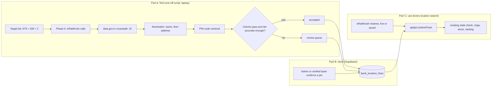

# Plan: let location search see the banks it can't place (#33, #34)

**Status: PLAN, not started.** Nothing has been built, run or written to the database. Work starts only when you ask.

- Paths are relative to `bloodlink/` unless they start with `../`.
- Counts are from the 23 and 24 October checks (`data_integrity.md`) unless a step says it re-measures them.
- Issue numbers are the stable IDs in `CLAUDE.md`.

**Contents**
1. [Why](#why)
2. [Where it stands](#where-it-stands)
3. [Goals and non-goals](#goals-and-non-goals)
4. [Design at a glance](#design-at-a-glance)
5. [Part A: finding positions](#part-a-finding-positions)
6. [Part B: storing positions](#part-b-storing-positions)
7. [Part C: using them in search](#part-c-using-them-in-search)
8. [Part D: measuring before and after](#part-d-measuring-before-and-after)
9. [Steps](#steps)
10. [Decisions and alternatives](#decisions-and-alternatives)
11. [Risks](#risks)
12. [What to update when it's done](#what-to-update-when-its-done)
13. [Sources](#sources)

---

## Why

Location search can't see up to **885** stocked banks:

| Group | Banks | Why search can't see them | Where they come from |
|---|---|---|---|
| No coordinates (#33) | 679 (432 blood banks, 247 storage units) | eRaktKosh's `nearest` call doesn't return them at all | `blood-availability` only, so they sit in `bank_stock_latest` with no row in `blood_banks` |
| Wrong state (#34) | up to 206 | `nearest` places them outside their own state, so `stateBounds.js` leaves them out (#36) | `blood_banks.location_quality = 'wrong_state'` |
| Outside India | 2 | Same, with a point in the sea | `location_quality = 'outside_india'` |

"Up to 206" because some wrong-state banks are among the 300 directory banks with no stock row. Step 1 measures the exact figure.

Why it matters:
- These banks are 14% to 19% of everything eRaktKosh lists. Region search still shows them, but a user who shares a location never sees them.
- Storage units (BSUs) are often the only stock in a rural block, so the gap is worst where the rings are already widest.
- The reviewer's point 3 asked how the data is validated. "We found 885 unusable positions and fixed N of them, with this measured accuracy" is a stronger answer than "we hid them".

---

## Where it stands

Three facts about the current code shape the whole plan:

1. **Location search never reads `blood_banks` while eRaktKosh is up.** `src/app/api/blood-search/route.js` takes positions from the live `nearest` answer. It reads the saved directory (`loadSavedNearest` in `src/lib/stockStore.js`) only when eRaktKosh is down. So writing corrected coordinates into `blood_banks` would change nothing for a normal search.
2. **The weekly directory run would overwrite any correction.** `snapshotDirectory()` in `scripts/snapshot.mjs` upserts with `on conflict do update set latitude = excluded.latitude, longitude = …, location_quality = …`. Every Monday, eRaktKosh's wrong point would come back.
3. **The 679 have no directory row to correct.** They exist only in `bank_stock_latest`, with a name and address inside the `row` jsonb but no position and usually no district.

So the work has three parts: **find** positions (Part A), **store** them where the collector can't overwrite them (Part B), and **merge** them into every location search (Part C). Part D measures the effect.

What already exists:
- `../blood_data/crosswalk/coordinates_for_unlocated_banks.csv`: 15 coordinate-less banks placed confidently from data.gov.in. Not applied yet.
- The distinctive-word name matcher from report 3, D3.2.2 (generic words and place names removed before comparing). Its precision-first rule is kept here.
- `src/lib/stateBounds.js`: checks that a point lies in its own state, with a 5 km margin. Every new position must pass it.
- The search page's credit line already credits OpenStreetMap.

---

## Goals and non-goals

**Goals**
- A clear before-and-after number for the report: stocked banks visible to location search, and the units they hold.
- **Precision over recall.** A bank placed in the wrong place is worse than a bank not placed, because the ranking would send someone there. The same rule as D3.2.2.
- A placed bank must be **no less accurate than a `shared`-point bank**, which search already uses ("may be off by a few km").
- Every position records where it came from and how accurate that source has been measured to be.
- Follow the [Nominatim usage policy](https://operations.osmfoundation.org/policies/nominatim/) to the letter (see [request budget](#request-budget-and-the-nominatim-policy)).

**Non-goals for this plan**
- Re-placing the 518 `shared`-point banks. The same pipeline can run on them later as an optional phase; they are already visible.
- Merging the 6 likely duplicate code pairs. They need a phone call or the licence list, not geocoding.
- Changing region search. It already lists every bank.

---

## Design at a glance



The control experiment (Part A) runs the same pipeline on banks whose position is already known, to measure how accurate each step is before any result is trusted.

---

## Part A: finding positions

### The source ladder

Each target bank goes down the ladder and stops at the first step that gives an accepted position.

| Step | Source | Applies to | Cost | Expected precision | Status |
|---|---|---|---|---|---|
| 0 | eRaktKosh's other public calls: `bloodbanks?stateCode=`, `camps/hospitalCode` | all 887 | 36 calls, under a minute, plus one call per sampled bank | Unknown: check whether any of them carries coordinates, a district or a cleaner address | To check |
| 1 | data.gov.in directory crosswalk | 15 | Already done | Within 300 m of a matching data.gov.in point | Ready to apply |
| 2 | Nominatim, the bank's or its parent hospital's **name** as a point of interest | the rest | 1 request a bank | Building level when it matches | Script to write |
| 3 | Nominatim, the bank's **address** (structured, with the PIN code) | banks step 2 didn't place | 1 to 2 requests a bank | Street to locality level | Script to write |
| 4 | **PIN-code centroid**, offline, from India Post's directory on data.gov.in | banks with a PIN in their address | No requests | Locality level; a few km in towns, more in rural PINs | Download to check |
| 5 | **Manual placement** by an admin, or confirmation by the bank's own verified account | whatever is left | About a minute a bank by hand | Building level | Needs the review page (Part B) |

**Preparing the inputs (before step 2).** For each target, build one clean record from `bank_stock_latest.row` and, for wrong-state banks, `blood_banks`:
- `name` through `cleanText`, with "Blood Bank", "Blood Centre", "BSU" and "Blood Storage Unit" stripped for searching.
- **Parent hospital.** Storage units are usually named after the hospital they sit in, for example "BSU, CHC Foo" or "Blood Storage Centre, District Hospital Bar". The parent hospital's name is what OpenStreetMap is likely to hold.
- **PIN code:** the first six-digit number starting 1 to 9 in the address (`\b[1-9][0-9]{5}\b`).
- **District:** `district_id` when known, else the first district name from `assets/district_data.json` for that state that appears in the address.
- **State:** always known (the stock call is per state). It sets the search box and the final check.

### Nominatim queries

Every query sends `countrycodes=in`, `format=jsonv2`, `addressdetails=1`, `limit=5`, an honest User-Agent naming bloodLink and a project contact address, and a `viewbox` of the bank's own state from `assets/state_boundaries.json` with `bounded=1`. Results outside the state can't come back.

1. **Name query:** `q = <distinctive name words> <district> <state>`. Keep only results whose category is a health facility (`amenity=hospital|clinic|doctors`, `healthcare=*`, `building=hospital`).
2. **Structured address query:** `street`, `city`, `county` (district), `state`, `postalcode`, `country=India`.
3. **Free-form address query**, only when the structured query found nothing: the cleaned address with phone numbers and the bank's own name removed.

### Checks every result must pass

A candidate position is kept only if all of these hold:

| Check | Rule | Why |
|---|---|---|
| Own state | `stateBounds.locationProblem()` returns `null` | The fault this plan exists to fix |
| Own district | Inside the district outline (geoBoundaries ADM2, matched by name) when one exists; otherwise within 25 km of the PIN centroid when a PIN is known | Catches a same-named hospital in the next district |
| Name evidence (name queries only) | At least one distinctive word in common, as in D3.2.2 | "District Hospital" alone matches dozens of places |
| Not a centroid trap | Not on a point that 3 or more other results also landed on | Geocoders fall back to a town's centre for every address they can't parse |
| Specific enough | Nominatim `place_rank` 26 or more (street or building) for steps 2 and 3 | A city-level answer is not a bank's position |

### The control experiment: how accurate is each step?

Accuracy is measured, not assumed, before any result reaches the search.

- **Truth set:** banks where eRaktKosh and data.gov.in agree within 300 m. Two independent sources agreeing is the best truth available. Take a stratified sample of 200: blood banks and storage units, urban and rural, and at least 15 states.
- **Run:** the same ladder (steps 2 to 4) with their coordinates hidden.
- **Measure, per step:** how many it placed (yield), median error, 90th-percentile error, the share within 1, 2 and 5 km, and **false matches** (more than 10 km off).
- **Acceptance rule, fixed before the results are seen:**
  - A step's results go into location search automatically only if its **90th-percentile error is 2 km or less** and its **false-match rate is 2% or less**.
  - Otherwise its results go to the review queue.
- **Tiers come from these numbers, not from the method's name.** If PIN centroids turn out to be within 2 km at the 90th percentile in cities, they can be accepted for city banks only.
- **Known bias:** the truth set leans towards older, well-documented banks, because the data.gov.in list is older. The targets include many storage units and newer banks. Expect a lower **yield** on the targets than on the control; **accuracy** per accepted match should transfer better than yield does. The report must say so.

### Request budget and the Nominatim policy

Nominatim is the public OpenStreetMap geocoder. **Read and follow its usage policy: <https://operations.osmfoundation.org/policies/nominatim/>.** What it requires, as of the reading for this plan:

- An absolute maximum of **1 request a second**, from one application.
- A valid **User-Agent or Referer identifying the application**. Library defaults are not acceptable.
- **Attribution** (the search page already credits OpenStreetMap) and the ODbL share-alike licence.
- Bulk geocoding is discouraged in general. A **one-time** bulk task may be acceptable if it runs on a **single thread on one machine**, with no distributed scripts, and **caches every result locally**.
- Scripts that run longer than a day, or **at regular intervals, are capped at 4 requests a minute.**
- Repeating the same query can get a client blocked. No grid queries and no bulk downloading of points of interest.

The budget:

| Run | Banks | Requests at most (3 each) | Time at 1 a second | Likely time |
|---|---|---|---|---|
| Control | 200 | 600 | 10 min | 6 min |
| Targets | 887 minus the 15 already placed | 2,616 | 44 min | 25 to 30 min |
| **One request per target bank** (the figure in the request) | 885 | 885 | **about 15 min** | |

- One thread, one machine, with a 1.1 s gap so jitter never breaks the limit.
- Every response is cached in `../blood_data/geocoding/nominatim_cache.ndjson`, keyed by the full query. A re-run reads the cache and sends nothing it has sent before.
- The run stops itself on any HTTP 429 or 403 and records where it stopped.
- **Afterwards,** only new banks need placing, a few a week at most. A weekly job is "regular intervals", so it runs at 4 requests a minute or less.

---

## Part B: storing positions

### A table of fixes, separate from the directory

A new migration, for example `supabase/migrations/20261101000100_bank_location_fixes.sql`. A sketch:

```sql
create table public.bank_location_fixes (
  hospital_code text primary key check (hospital_code ~ '^[0-9]{1,10}$'),
  state_code text not null check (state_code ~ '^[0-9]{1,3}$'),
  latitude double precision not null check (latitude between 6 and 37.5),
  longitude double precision not null check (longitude between 68 and 97.5),
  -- why eRaktKosh's own point couldn't be used when this fix was made
  reason text not null check (reason in ('missing', 'wrong_state', 'outside_india', 'shared')),
  method text not null check (method in
    ('eraktkosh_other', 'datagov', 'nominatim_name', 'nominatim_address', 'pincode',
     'manual', 'bank_confirmed')),
  -- 90th-percentile error of this method, from the control experiment
  precision_m integer not null check (precision_m > 0),
  evidence jsonb not null default '{}'::jsonb,  -- query, matched name, OSM id, data.gov.in row
  status text not null default 'proposed'
    check (status in ('proposed', 'accepted', 'rejected', 'superseded')),
  created_at timestamptz not null default now(),
  reviewed_by uuid references public.profiles (id) on delete set null,
  reviewed_at timestamptz,
  location extensions.geography(Point, 4326) generated always as (
    extensions.st_setsrid(extensions.st_makepoint(longitude, latitude), 4326)::extensions.geography
  ) stored
);
create index bank_location_fixes_location_gist on public.bank_location_fixes using gist (location);
```

Access, in the style of the existing migrations:

| Who | Can |
|---|---|
| Anyone (publishable key) | Read rows with `status = 'accepted'`, through a policy. Bank positions are public, as in `blood_banks`. |
| Admins | Read every row. Accept, reject or move a pin only through `review_bank_location(code, decision, lat, lng, note)`, a `security definer` function that checks `is_admin()` and writes `audit_log`, like `review_organization()`. |
| `bloodlink_ingest` | Insert `proposed` and `accepted` rows (the script), and set `superseded` (the weekly directory run). Nothing else. |
| A verified blood-bank account | Later: confirm its own bank's pin through a function that checks the account's linked eRaktKosh code (see `plan_panels.md`). |

**Which position wins.**
- A **human-confirmed** fix (`manual` or `bank_confirmed`) always wins, even over a later eRaktKosh point.
- A **machine** fix applies only while eRaktKosh's own point is unusable (`missing`, `wrong_state` or `outside_india`).
- The weekly directory run adds one step: if eRaktKosh now gives a usable point for a machine-fixed bank, mark the fix `superseded`. If the new point is more than 2 km from the fix, log it for review instead of deciding.
  - If `supabase_scheduler.md` has been carried out by then, this step goes in the shared `src/lib/collector.js`, not in `scripts/snapshot.mjs`, so the cloud and laptop runs both do it.

### The review page

`/admin/locations`, built on the existing admin layout and `BloodMap.js` (loaded with `dynamic(..., { ssr: false })`):
- A queue of `proposed` fixes and unplaced banks, worst first (most units held, then no position at all).
- For each: name, address, state and district, the evidence, and a draggable pin on the map. Buttons: accept, move and accept, reject, can't place.
- Links that open OpenStreetMap and a web search for the name in a new tab, for the admin's own checking. The page itself sends nothing to outside services.
- At about a minute a bank, two people clear 100 banks in an hour.

---

## Part C: using them in search

### Merge after `nearest`, before the state check

A pure function, so it can be unit-tested and reused by scripts:

```text
# src/lib/bankLocations.js (new, pure)
applyLocationFixes(nearbyBanks, fixes, origin, radiusM, stateChecker):
    byCode = fixes keyed by hospitalCode
    result = []
    for bank in nearbyBanks:
        fix = byCode[bank.hospitalCode]
        if fix and (fix is human-confirmed or stateChecker.locationProblem(bank) != null):
            bank = bank with fix's latitude and longitude, dist = haversine(origin, fix),
                   locationSource "fixed", locationPrecisionM fix.precisionM
        result.add(bank)
    # Banks nearest didn't return near here: no coordinates, or a wrong point far away.
    for fix in fixes not already in result:
        d = haversine(origin, fix)
        if d <= radiusM:
            result.add({ hospitalCode, stateCode, latitude, longitude, dist: d,
                         locationSource "fixed", locationPrecisionM })
    return result
```

Wiring:
- **`src/lib/stockStore.js`** gains `loadLocationFixes()`: accepted fixes read with the publishable key, cached for an hour like `loadDirectory`. About 900 rows, so a scan in memory costs a fraction of a millisecond (report 3, point 4: 0.1 ms for 4,328 banks).
- **`src/app/api/blood-search/route.js`** calls `applyLocationFixes` right after `fetchNearest`, then runs the existing `stateChecker` filter unchanged.
  - The live and saved paths both pass through it, because both come out of `fetchNearest`.
  - `misplacedBanks` then counts only banks that are still misplaced.
  - Added banks join the per-state stock lookups through their `stateCode`. Their name, address and phone already come from the stock row (`toBankResult` prefers it).
- **Response:** a new `relocatedBanks` count, and on each bank `locationSource` (`eraktkosh` or `fixed`) and `locationPrecisionM`.
- **Page:** a small grey note on fixed banks, "Location from its address", and the error radius when it's over 500 m.
- **Switch:** `BANK_LOCATION_FIXES=off` skips the merge. It is used for the paired measurement in Part D and as a one-line rollback. Add it to the environment table in `CLAUDE.md`.
- **Region search** is unchanged.

**Tests** (`tests/bank-locations.test.js`): a wrong-state bank near the pin is moved; a wrong-state bank whose wrong point is far away but whose fix is near is added; a missing bank is added; a bank with a usable eRaktKosh point keeps it unless the fix is human-confirmed; a fix outside the radius is not added; superseded and rejected fixes are ignored.

---

## Part D: measuring before and after

### What to measure

| Measure | How | Why |
|---|---|---|
| **Stocked banks location search can see** | SQL over `bank_stock_latest`, `blood_banks` and the fixes (below) | The headline number |
| Banks still unplaced, by reason | Same query | Shows what remains for #33 and #34 |
| **Units visible**, all red cells and O- red cells | `scripts/location-coverage.mjs` (new), parsing rows with `parseQuantities` | A placed bank with 200 units matters more than one with 2 |
| **Gap closed** | For each newly placed bank, the distance from its new position to the nearest bank that was visible before | "Patients near these banks previously had to look N km further" |
| Ring and shortfall in probe searches | Offline replay of the ring and plan logic over one saved snapshot, with and without fixes | Shows the effect on real answers |
| **Placement accuracy** | The control experiment, per step | Lets the report defend the new positions |
| Delhi check | `misplacedBanks` in the central Delhi ranked search (44 within 25 km today) | Ties back to fault #36 |

### The baseline query

Run before anything is applied, and again after:

```sql
-- Stocked banks by what location search can do with them.
select
  case
    when f.hospital_code is not null then 'usable: fixed'
    when b.hospital_code is null or b.latitude is null then 'hidden: no coordinates'
    when b.location_quality in ('wrong_state', 'outside_india') then 'hidden: ' || b.location_quality
    else 'usable: eRaktKosh point'
  end as visibility,
  count(*) as banks
from public.bank_stock_latest s
left join public.blood_banks b using (hospital_code)
left join public.bank_location_fixes f
  on f.hospital_code = s.hospital_code and f.status = 'accepted'
group by 1
order by 1;
```

Before the fixes table exists, drop its join. Expect about 3,820 usable (4,028 in both lists, minus the wrong-state and outside-India banks that also have stock) and 679 with no coordinates.

### Why replay offline rather than compare live searches

Live stock changes hour by hour, so a search run today and again next week would differ for reasons that have nothing to do with positions.
- **The primary number** comes from one saved snapshot (`bank_stock_latest` plus the directory at one time), replayed with and without the fixes. Only positions change between the two runs.
- **A live demonstration:** two servers started at the same minute, one with `BANK_LOCATION_FIXES=off`, both with `TRUSTED_PROXY_HOPS=1`, sent the same probe searches together.
- **Probe points:** the 13 places in `scripts/ranking-sensitivity.mjs`, Saifai, Panaji and Satara, and the position of every newly placed bank.

### The table for the report

| Measure | Before | After | Change |
|---|---|---|---|
| Stocked banks visible to location search | ~3,820 (81%) | | |
| No coordinates | 679 | | |
| Wrong state or outside India (with stock) | ≤ 208 | | |
| Red-cell units visible | | | |
| O- red-cell units visible | | | |
| Probe searches ending in a shortfall | | | |
| Median ring radius over the probe searches | | | |
| Central Delhi `misplacedBanks` within 25 km | 44 | | |

Plus the accuracy table from the control: step, banks placed, median error, 90th-percentile error, within 1 km, false matches.

---

## Steps

| Phase | What | Time | You need to |
|---|---|---|---|
| 0 | Check `bloodbanks?stateCode=` and `camps/hospitalCode` for coordinates, districts or cleaner addresses. Download the PIN directory and check its licence and quality. Download geoBoundaries' district outlines (ADM2) for the district check, and match their names to `district_data.json`. | 2 h | Nothing |
| 1 | Baseline: the SQL above and the offline replay, saved to `../blood_data/measurements/locations/before/` | 1 h | Nothing |
| 2 | Migration for `bank_location_fixes` and `review_bank_location()`. Apply it. Load the 15 data.gov.in placements as `accepted`. | Half a day | Run `npm run db:migrate` |
| 3 | `scripts/place-banks.mjs`: the ladder, checks and cache. Dry run by default; `--apply` writes as `bloodlink_ingest`, like `snapshot.mjs`. Then the control run. | 1 day | Read the control results and agree the thresholds |
| 4 | Target run, unattended | About 30 min | Leave the laptop on |
| 5 | `/admin/locations` review page; review the queue | 1 day to build, 2 to 4 h to review | Review with a teammate |
| 6 | `applyLocationFixes`, the loader, route and page changes, the switch, the supersede step in `snapshot.mjs`, tests | 1 day | Nothing |
| 7 | After measurement, both offline and live; update the documents | Half a day | Nothing |

Lint, the format check, the tests and the build must pass after phases 2, 5 and 6.

---

## Decisions and alternatives

**L1 · Nominatim first, among the geocoders.**
- *Why:* free, no key, OpenStreetMap data (already credited), and results may be stored and reused.
- *Alternatives:*
  - **Google Geocoding API:** probably the best Indian address coverage. But its service terms allow latitude and longitude to be cached for at most 30 consecutive days, so a permanent fixes table would break them. It also needs a billing account. Fine for a person checking a pin by hand on the review page; not for the table.
  - **OpenCage:** aggregates several geocoders and allows permanent storage, but its free trial is for testing only. A paid plan would be needed for production.
  - **LocationIQ, Geoapify:** OpenStreetMap-based, with keys and free tiers. They give little that Nominatim doesn't for a one-off run.
  - **Mappls (MapmyIndia):** strong on Indian addresses, but it needs a key and its licence would need reading for storage.
  - **Photon:** OpenStreetMap-based, good at names, weaker on structured Indian addresses.
  - **Self-hosting Nominatim** with an India extract: no limits, but hours of import and a large disk for 885 banks. Worth it only if geocoding becomes a regular feature (for example, donor addresses; see `plan_donor_network.md`, which avoids it).
  - **Other health-facility lists:** the National Health Portal's hospital directory on data.gov.in and the ABDM Health Facility Registry may hold parent-hospital coordinates for storage units. Worth a check in Phase 0; the registry needs ABDM sandbox access.

**L2 · A separate fixes table, not new columns on `blood_banks`.**
- *Why:* the weekly directory upsert can't overwrite it; it can hold the 679 banks that have no directory row; every position keeps its source and accuracy; one `delete` or the switch undoes it all.
- *Alternatives:*
  - **Columns on `blood_banks`** (`location_source`, a guarded upsert): one table to read, but the collector's upsert becomes conditional, and the 679 need placeholder directory rows that `nearest` never returns.
  - **A JSON file in `assets/`:** simplest, but no review workflow, no audit and a redeploy for every change.

**L3 · Accept by measured accuracy, not by method.**
- *Why:* a PIN centroid can be within a kilometre in a dense city and 15 km off in a hill district. The control experiment says which is which.
- *Alternative:* fixed tiers by method. Easier to explain, but they would accept bad rural answers and reject good urban ones.

**L4 · Low-precision positions stay out of location search.**
- *Why:* the bar is "no worse than a shared-point bank". A bank 8 km from its pin would get a misleading ETA and rank.
- *Alternative:* include them with a wide error radius and an "approximate" badge, and widen their ETA. Kinder to recall, but it puts uncertainty into the ranking that the formulas don't model. Revisit if the review queue stays long.

**L5 · Merge in the route, not inside the eRaktKosh client.**
- *Why:* `src/lib/eraktkosh.js` caches eRaktKosh's own answers, and the saved-copy fallback relies on them keeping eRaktKosh's shape. The route is where positions are already judged (`stateChecker`), so the merge sits next to it.
- *Alternative:* merge inside `fetchNearest`. One call site fewer, but the cache would hold a mix of eRaktKosh data and ours.

**L6 · Human confirmation beats eRaktKosh; machine fixes yield to it.**
- *Why:* if eRaktKosh corrects a bank, its point comes from the bank itself and should win over a geocoder. A pin a person checked should win over both.

**L7 · Before and after from one snapshot.**
- *Why:* only positions change between the two runs, so the difference is caused by the fix and nothing else.

---

## Risks

| Risk | Effect | Mitigation |
|---|---|---|
| Nominatim knows few rural hospitals and storage units | Low yield on exactly the banks that matter most | Parent-hospital names, PIN centroids for cities, the review page and bank self-confirmation (`plan_panels.md`) |
| A same-named hospital in the next district | A bank placed in the wrong town | District check, distinctive-word rule, false-match rate measured in the control |
| Addresses with wrong or missing PIN codes | Wrong centroid | PIN result must agree with district; centroid traps rejected |
| Nominatim blocks the client | Run stops partway | Single thread, 1.1 s gap, cache, stop on 429 or 403, resume from cache |
| eRaktKosh renumbers or removes a bank | Orphan fix | Weekly run marks fixes for codes missing from both eRaktKosh lists for 4 weeks |
| ODbL share-alike | Positions derived from OpenStreetMap carry its licence | Record `method` and `evidence` per row, keep the attribution, and keep OSM-derived rows identifiable |

---

## What to update when it's done

- **`CLAUDE.md`:** delete #33 and #34, or shrink them to what remains, without renumbering. Add `BANK_LOCATION_FIXES` to the environment table, the new table to the data model, `bankLocations.js` to the modules, the review page to the routes, and a verification step ("a missing bank with an accepted fix appears in a nearby location search").
- **`md files/CODE_REFERENCE.md`:** every new function and variable.
- **`md files/data_integrity.md`:** "What remains" and the before-and-after table.
- **`md files/report3.md`** (point 3) and **`md files/features.md`:** the new numbers and the accuracy table.

---

## Sources

- [Nominatim usage policy](https://operations.osmfoundation.org/policies/nominatim/) (OpenStreetMap Foundation): 1 request a second, identifying User-Agent, attribution, ODbL, rules for one-time bulk tasks, 4 a minute for periodic scripts.
- [Google Maps Platform service specific terms](https://cloud.google.com/maps-platform/terms/maps-service-terms/index-20240522): Geocoding API latitude and longitude may be cached for up to 30 consecutive calendar days.
- [OpenCage pricing](https://opencagedata.com/pricing): free trial for testing; permanent storage allowed.
- All India Pincode Directory with latitude and longitude, data.gov.in (listed in the [Open Knowledge index](https://2015.index.okfn.org/place/india/postcodes) and [mirrors](https://ndp.ckan.civicdatalab.in/dataset/all-india-pincode-directory)). The licence and coordinate quality need checking in Phase 0.
