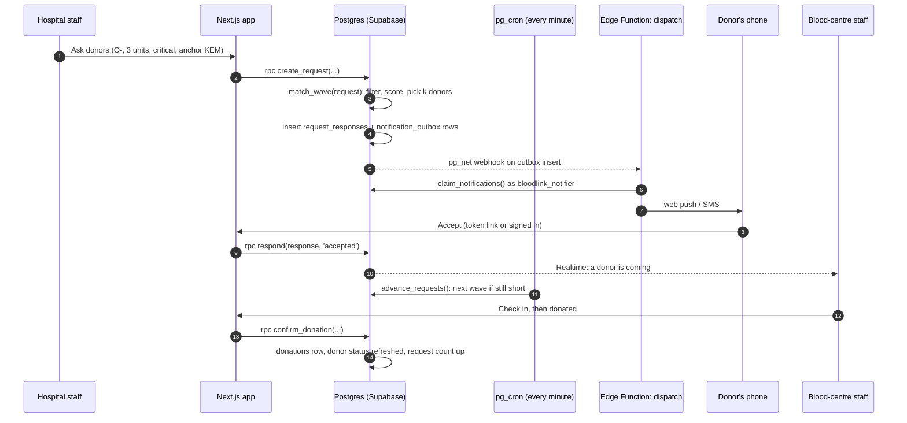
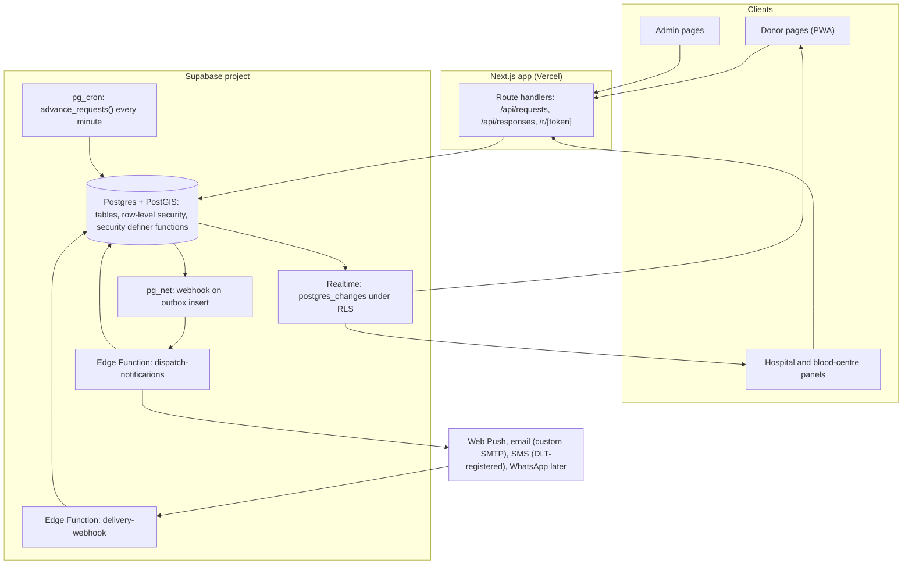
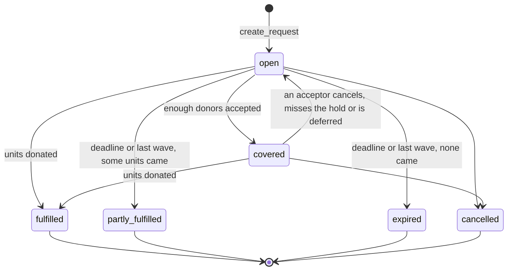
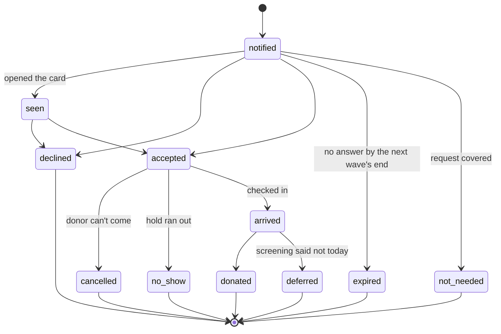

# Plan: the peer-to-peer donor network

**Status: PLAN, not started.** Nothing has been built. The architecture, logic and defaults below are proposals with reasons. Every default marked *assumption* must be calibrated in shadow mode or the pilot before it is trusted.

- Paths are relative to `bloodlink/` unless they start with `../`.
- It builds on `CLAUDE.md` ("Where to go next", item 6), report 3 (point 4's PostGIS benchmark, point 5's donor-response model R and notification tests) and `plan_panels.md` (organization members, notifications inbox, two-factor sign-in).
- Medical and legal statements here are a starting point for review by the project guide and a blood-bank medical officer, not advice.

**Contents**
1. [What it is](#what-it-is)
2. [The legal and clinical frame](#the-legal-and-clinical-frame)
3. [Goals, non-goals and success measures](#goals-non-goals-and-success-measures)
4. [People and journeys](#people-and-journeys)
5. [Request types](#request-types)
6. [Architecture](#architecture)
7. [Data model](#data-model)
8. [Matching logic](#matching-logic)
9. [Lifecycles](#lifecycles)
10. [Notifications](#notifications)
11. [Privacy, safety and abuse](#privacy-safety-and-abuse)
12. [Eligibility inside the database](#eligibility-inside-the-database)
13. [Scale and performance](#scale-and-performance)
14. [Measuring it](#measuring-it)
15. [Testing and simulation](#testing-and-simulation)
16. [Rollout](#rollout)
17. [Decisions and alternatives](#decisions-and-alternatives)
18. [Risks](#risks)
19. [Open questions](#open-questions)
20. [Sources](#sources)

---

## What it is

When a hospital or blood bank needs a blood group it can't find in stock, bloodLink asks nearby eligible donors of that group to **go and donate at that blood centre**. Donors accept or decline in the app. The centre sees who is coming, screens them, collects the blood, and confirms the donation, which updates the donor's eligibility by itself.

"Peer to peer" means connecting people who can give with a specific need. It never means blood passing from one person to another outside a blood centre.

---

## The legal and clinical frame

These facts decide the architecture more than any technical choice. Have the project guide confirm each before the pilot.

| Fact | Consequence for the design |
|---|---|
| In India, blood is collected, tested and issued only by **licensed blood centres**, under the Drugs and Cosmetics Act, 1940 and its 1945 Rules. | **Every request is anchored to a blood centre** (or a hospital with one). A donor goes there, never to a patient. The app never arranges a transfusion. |
| **Paid ("professional") donation has been banned since 1 January 1998**, following the Supreme Court's 1996 judgment in *Common Cause v. Union of India*. The National Blood Policy aims for 100% voluntary, non-remunerated donation. | **No money anywhere in the system.** Every notification says bloodLink never asks for money. Requests can't carry offers, fees or rewards. |
| National policy encourages **voluntary** donation and discourages **replacement** donation, where a patient's family is asked to bring donors. *Check NBTC's current guidance.* | The default request is "donors of this group needed at this centre", credited to the centre's stock. A patient-specific request is supported only when raised by the verified institution treating the patient. |
| **Screening and cross-matching are the blood centre's job.** bloodLink's eligibility check is informational (#24). | The app can say "you may be eligible"; only the centre says "you can donate today". A deferral at screening is normal and never counts against the donor. |
| The **Digital Personal Data Protection Act, 2023** requires notice, specific consent, a way to withdraw it, and erasure on request. Blood group, health answers and location are personal data; health data deserves the most care. | A **separate, explicit consent** to join the network; approximate locations only; contact details revealed only on acceptance; retention limits; self-service deletion (#18). |
| Donor-selection thresholds come from NBTC's guidelines (2017, as cited in `src/lib/eligibility.js`). Some values in the current form, such as the 6-month tattoo window and 50 kg, are not yet checked (#24). | Fix #24 **before** eligibility is used to choose whom to message. |

---

## Goals, non-goals and success measures

**Goals**
1. Cover an urgent need that stock can't, faster than phone trees and WhatsApp groups do, and with fewer people disturbed.
2. Never put a donor's safety, privacy or goodwill at risk to do it.
3. Close the loop: every request ends as fulfilled, partly fulfilled, expired or cancelled, with the reason recorded.

**Non-goals (for now):** public requests from unverified individuals; payments; live GPS tracking of donors; a native app; donor-to-patient contact.

**How success is measured in the pilot** (targets are *assumptions* to revisit after shadow mode):

| Measure | Definition | Pilot target |
|---|---|---|
| Fill rate | Units donated for a request ÷ units it asked for, by its "needed by" time | ≥ 60% for critical and urgent |
| Time to first acceptance | Request opened → first donor accepts | Median ≤ 15 min for critical |
| Notifications per unit | Donors notified ÷ units donated | ≤ 15 |
| Show rate | Donors who arrive ÷ donors who accepted | ≥ 70% |
| Fatigue | Donors who opt out within 7 days of a notification ÷ donors notified | ≤ 2% |
| Safety | Requests reported as fake or asking for money | 0 left open after 1 hour |
| Delivery latency | Queued → delivered, 95th percentile | In-app under 2 s, SMS under 30 s (report 3, point 4) |

---

## People and journeys

| Person | Account | What they do here |
|---|---|---|
| **Donor** | Any signed-in user who joins the network | Sets areas and availability, gets requests, accepts or declines, checks in |
| **Blood-centre staff** | Member of a verified `blood_bank` organization (`plan_panels.md`, F1) | Raises appeals, sees who is coming, checks donors in, confirms donations |
| **Hospital staff** | Member of a verified `hospital` organization | Escalates a shortfall from the response plan to donors, anchored to a chosen centre |
| **Admin** | Admin roles (`plan_panels.md`) | Watches open critical requests, handles reports, suspends misuse |

**Journey 1 · A donor joins.** Profile complete → "Join the donor network" → reads a one-screen notice (what is shared, with whom, for how long, how to leave) → ticks consent → picks one or two areas on a map → sets availability and quiet hours → turns on browser notifications. Their eligibility shows as today.

**Journey 2 · A hospital escalates a shortfall.** A critical ranked search for 4 units of O- red cells finds 1 → the plan shows a shortfall of 3 → "Ask donors" → picks the anchor centre (by default the bank the plan used, or the hospital's own) → the centre's staff see it and may tick "compatible groups acceptable" → matching starts.

**Journey 3 · A donor responds.** A push notification: "O- donors needed at KEM Hospital Blood Centre, about 4 km away, by 6:30 pm" → opens the request card → Accept → sees the centre's address, a map link, the centre's phone and a check-in code → goes.

**Journey 4 · The centre confirms.** The donor arrives and shows the code → staff mark "arrived" → after screening, "donated" or "deferred" (no reason stored) → the request's count goes up, and the donor's next eligible date updates.

**Journey 5 · A blood centre appeals.** B- stock is low for the week → "Appeal for donors" with dates and slots → donors book a slot → the same check-in flow. Later, the forecast (report 3, point 5) suggests appeals before the stock drops.



---

## Request types

| Type | Raised by | Group rule | Typical urgency | Notes |
|---|---|---|---|---|
| **Shortfall** | Verified hospital or blood centre | Exact group; compatible groups only if the centre allows it | Critical, urgent | The emergency path, from a response plan |
| **Platelet apheresis (SDP)** | Verified blood centre with apheresis | Exact ABO by default | Urgent | Dengue season makes this common. Donors must opt in to apheresis; extra screening at the centre |
| **Centre appeal** | Verified blood centre | One or more groups, or any group | Routine | For stock running low over days, with booked slots |
| **Forecast appeal** (later) | The forecast job, approved by the centre | The groups at risk | Routine | Report 3, point 5: "donor alerts" |
| **Camp** (later) | Verified blood centre | Any | Routine | From eRaktKosh's camp data or created in the panel |

**Group policy, consistent with report 3's D1.4.**
- **Exact first.** Waves 1 and 2 ask only donors of the patient's exact group. This keeps scarce O- donors for O- patients, the same reason search counts exact stock only.
- **Compatible later, with consent.** From wave 3, if the centre ticked "compatible groups acceptable", donors from `donorGroupsFor(recipientCode, componentCode)` in `src/lib/compatibility.js` are added, ranked below exact matches. The centre still cross-matches.
- **Bombay (Oh):** only Bombay donors, ever (already in `compatibility.js`).

---

## Architecture



| Part | Job | Why here |
|---|---|---|
| **Next.js route handlers** | Validate input with whitelist validators, call database functions as the signed-in user, serve token links | Same pattern as `/api/details` and `/api/organization` |
| **Postgres functions** | `create_request`, `match_wave`, `respond`, `check_in`, `confirm_donation`, `cancel_request`, `advance_requests` | Matching reads other people's rows, so it must run as `security definer` with its own checks, never with a service-role key (`CLAUDE.md`) |
| **pg_cron** | Each minute: next waves, expiries, hold timeouts, retrying stuck notifications | Already planned for the collector (`supabase_scheduler.md`); one scheduler for both |
| **Outbox + dispatcher** | `notification_outbox` rows become messages; an Edge Function sends them | Sending needs HTTP and provider secrets, which don't belong in SQL or in the browser |
| **`bloodlink_notifier` role** | The dispatcher connects with `SUPABASE_DB_URL` and runs `set role bloodlink_notifier`, which can only claim and update outbox rows through two functions | The same least-privilege pattern as `bloodlink_ingest` and the collector plan |
| **Realtime** | Live updates to donors' inboxes and organizations' request boards | Realtime's `postgres_changes` respects row-level security, so no extra filtering service |

---

## Data model

Sketches. Each becomes a timestamped migration with explicit grants and CHECK constraints mirrored in JS validators (`CLAUDE.md`, "Schema changes").

```sql
-- Consent, versioned, so a changed notice needs fresh consent.
create table public.consents (
  user_id uuid not null references public.profiles (id) on delete cascade,
  purpose text not null check (purpose in ('donor_network', 'share_phone_with_centre', 'sms')),
  notice_version text not null,
  given_at timestamptz not null default now(),
  withdrawn_at timestamptz,
  primary key (user_id, purpose, notice_version)
);

-- What a donor wants. Client-writable through column grants.
create table public.donor_settings (
  user_id uuid primary key references public.profiles (id) on delete cascade,
  is_available boolean not null default true,
  snoozed_until timestamptz,
  quiet_start time default '22:00',            -- India time
  quiet_end time default '07:00',
  critical_overrides_quiet boolean not null default false,
  max_requests_per_week smallint not null default 2 check (max_requests_per_week between 1 and 7),
  apheresis_willing boolean not null default false,
  channels text[] not null default '{in_app,push}'
);

-- Up to two areas, stored as the centre of a ~1 km cell (lat and lng rounded to 0.01°).
create table public.donor_areas (
  user_id uuid not null references public.profiles (id) on delete cascade,
  label text not null check (label in ('home', 'work')),
  cell extensions.geography(Point, 4326) not null,
  primary key (user_id, label)
);
create index donor_areas_cell_gist on public.donor_areas using gist (cell);

-- Computed by triggers, never by clients (see "Eligibility inside the database").
create table public.donor_status (
  user_id uuid primary key references public.profiles (id) on delete cascade,
  blood_group_code text not null,
  is_in_network boolean not null,              -- consent given and not withdrawn
  eligible_from date,                          -- null = not eligible (deferred or incomplete)
  needs_staff_check boolean not null default false,
  asks_total integer not null default 0,
  accepts_total integer not null default 0,
  shows_total integer not null default 0,
  last_asked_at timestamptz,
  asks_this_week smallint not null default 0,
  ignored_in_a_row smallint not null default 0
);
create index donor_status_matchable on public.donor_status (blood_group_code)
  where is_in_network and eligible_from is not null;

create table public.blood_requests (
  id uuid primary key default gen_random_uuid(),
  kind text not null check (kind in ('shortfall', 'apheresis', 'appeal', 'forecast', 'camp')),
  organization_id uuid not null references public.organizations (id),  -- who raised it
  anchor_organization_id uuid references public.organizations (id),    -- the centre donors go to
  anchor_hospital_code text,                                            -- or an eRaktKosh bank
  anchor_point extensions.geography(Point, 4326) not null,
  blood_group_code text not null,
  component_id text not null,
  units_needed smallint not null check (units_needed between 1 and 50),
  urgency text not null check (urgency in ('critical', 'urgent', 'routine')),
  needed_by timestamptz not null,
  allow_compatible boolean not null default false,   -- set by centre staff only
  patient_reference text check (char_length(patient_reference) <= 40), -- the hospital's own number
  -- travel conditions at creation, from src/lib/traffic.js, so SQL can estimate minutes
  zone_free_flow_kmh real not null,
  congestion_percent real not null,
  rain_factor real not null default 1,
  status text not null default 'open'
    check (status in ('open', 'covered', 'fulfilled', 'partly_fulfilled', 'expired', 'cancelled')),
  wave smallint not null default 0,
  next_wave_at timestamptz,
  units_donated smallint not null default 0,
  created_by uuid not null references public.profiles (id),
  created_at timestamptz not null default now(),
  closed_at timestamptz,
  close_reason text
);

create table public.request_responses (
  id uuid primary key default gen_random_uuid(),
  request_id uuid not null references public.blood_requests (id) on delete cascade,
  donor_id uuid not null references public.profiles (id) on delete cascade,
  wave smallint not null,
  score real not null,
  est_minutes smallint not null,
  is_exact_group boolean not null,
  status text not null default 'notified' check (status in
    ('notified', 'seen', 'accepted', 'declined', 'expired', 'not_needed',
     'cancelled', 'arrived', 'donated', 'deferred', 'no_show')),
  check_in_code text,                                 -- 6 characters, shown after accepting
  hold_until timestamptz,
  share_phone boolean not null default false,
  updated_at timestamptz not null default now(),
  created_at timestamptz not null default now(),
  unique (request_id, donor_id)
);

-- Single-use links in SMS and email; only a hash is stored.
create table public.response_tokens (
  token_hash bytea primary key,
  response_id uuid not null references public.request_responses (id) on delete cascade,
  expires_at timestamptz not null,
  used_at timestamptz
);

create table public.notification_outbox (
  id bigint generated always as identity primary key,
  user_id uuid not null references public.profiles (id) on delete cascade,
  response_id uuid references public.request_responses (id) on delete cascade,
  channel text not null check (channel in ('in_app', 'push', 'email', 'sms', 'whatsapp')),
  template text not null,
  payload jsonb not null,                -- no patient data; see "Notifications"
  status text not null default 'queued'
    check (status in ('queued', 'sending', 'sent', 'delivered', 'failed', 'cancelled')),
  attempts smallint not null default 0,
  next_attempt_at timestamptz not null default now(),
  provider_message_id text,
  last_error text,
  created_at timestamptz not null default now(),
  unique (response_id, channel)          -- never the same message twice
);

create table public.donations (
  id bigint generated always as identity primary key,
  donor_id uuid not null references public.profiles (id) on delete cascade,
  organization_id uuid references public.organizations (id),
  donated_on date not null check (donated_on <= current_date),
  kind text not null check (kind in ('whole_blood', 'apheresis_platelets', 'apheresis_plasma')),
  request_id uuid references public.blood_requests (id) on delete set null,
  source text not null check (source in ('centre_confirmed', 'self_reported')),
  created_at timestamptz not null default now()
);

create table public.contact_reveals (
  id bigint generated always as identity primary key,
  response_id uuid not null references public.request_responses (id) on delete cascade,
  revealed_to_org uuid not null references public.organizations (id),
  revealed_at timestamptz not null default now()
);

create table public.abuse_reports (
  id bigint generated always as identity primary key,
  reporter_id uuid not null references public.profiles (id) on delete cascade,
  request_id uuid references public.blood_requests (id) on delete set null,
  reported_user_id uuid references public.profiles (id) on delete set null,
  reason text not null check (reason in ('fake', 'money', 'harassment', 'wrong_details', 'other')),
  details text check (char_length(details) <= 500),
  status text not null default 'open' check (status in ('open', 'actioned', 'dismissed')),
  created_at timestamptz not null default now()
);
```

**Who can read and write what**

| Table | Donor | Org members | Admins | Functions and roles |
|---|---|---|---|---|
| `consents` | Own: read, give | — | Read (counts) | Withdrawal through `withdraw_consent()`, which also clears areas |
| `donor_settings`, `donor_areas` | Own: all | — | — | Matching reads them as `security definer` |
| `donor_status` | Own: read | — | Read, without health detail | Written only by triggers |
| `blood_requests` | Only requests they were notified about, through `my_request_cards()`, without `patient_reference` | Requests raised by or anchored at their organization | All | Created through `create_request()`, which checks membership role and suspension |
| `request_responses` | Own | Their requests' responses. **Donor name and phone appear only after acceptance, and phone only with `share_phone`**, through a view | All | Status changes only through `respond()`, `check_in()`, `confirm_donation()` |
| `notification_outbox` | — | — | Read | `bloodlink_notifier` through `claim_notifications()` and `finish_notification()` |
| `donations` | Own: read; add self-reported | Read the ones they confirmed | Read | Centre-confirmed rows only through `confirm_donation()` |
| `contact_reveals` | — | — | Read | Written by the view's function on first reveal |
| `abuse_reports` | Insert own | Insert own | All | — |

`donor_screening` stays owner-only. Matching never reads health answers directly; it reads `donor_status.eligible_from`, which the trigger derives from them.

---

## Matching logic

### Step 1: hard filters

A donor can be asked for a request only if **every** rule holds. All are indexed or cheap in SQL.

| # | Rule | Source |
|---|---|---|
| 1 | In the network: consent given, not withdrawn, not suspended | `donor_status.is_in_network`, `profiles.is_suspended` |
| 2 | Available: `is_available`, and not snoozed | `donor_settings` |
| 3 | **Group:** exact, or compatible when the request allows it and the wave is 3 or later | `compatibility.js` rules, as a lookup table in SQL |
| 4 | **Eligible by the deadline:** `eligible_from <= needed_by::date` | `donor_status` |
| 5 | Apheresis requests: `apheresis_willing` | `donor_settings` |
| 6 | **Within this wave's ring** of the anchor point, by either area | `ST_DWithin(donor_areas.cell, anchor_point, radius)` on the GiST index |
| 7 | **Not asked too often:** last asked over 72 h ago, and under the weekly cap. A critical request may skip the 72 h rule for donors who allowed it | `donor_status` |
| 8 | **Not in quiet hours**, unless critical and `critical_overrides_quiet` | `donor_settings`, India time |
| 9 | Not already asked for this request | `unique (request_id, donor_id)` |
| 10 | Not the person who raised it | — |

### Step 2: score

The bank ranking adds four "how good" parts (`ranking.js`). A donor's main uncertainty is different: **will they actually come?** So the donor score is an expected value: the chance this donor ends up donating, discounted by how long they take to get there.

```text
score = p_donate × e^(−minutes / τ) × rested × groupFit       (0 to 1)

p_donate  = respond × show
  respond = (accepts + 1) / (asks + 5)          # a new donor starts at 0.20   (assumption)
  show    = (shows + 4) / (accepts + 5)         # a new donor starts at 0.80   (assumption)
minutes   = straight-line km × 1.34 / zone free-flow km/h × 60
            × (1 + congestion % / 100) × rain factor
            # src/lib/traffic.js's straight-line estimate, with the request's stored
            # conditions; no donor position is ever sent to OSRM or anyone else
τ         = 30, 45 or 60 for critical, urgent or routine (ETA_DECAY_MINUTES in ranking.js)
rested    = min(1, 0.5 + days since last asked / 28)   # 0.5 just asked, 1 after two weeks
groupFit  = 1 for the exact group, 0.7 for a compatible group
```

- The two counts are **smoothed** (the +1 and +5 terms), so a donor who declined once isn't written off, and a new donor gets a fair chance. That keeps the network from asking the same reliable few forever.
- `e^(−minutes / τ)` is the same curve the bank ranking uses, so one explanation covers both.
- `rested` spreads requests across donors, which is fairer and fights fatigue.
- Ties are broken at random, so equal donors share the load.
- **Later:** report 3's response model R (logistic regression, then gradient-boosted trees, on recency, frequency, distance and past responses) replaces `p_donate` once a few hundred real asks are logged.

### Step 3: waves

Asking everyone at once is fast but wears donors out and sends too many people. Asking one at a time is gentle but far too slow for a critical case. Waves sit in between.

```text
match_wave(request):                               # request.wave counts from 0
    unitsLeft = units_needed − units_donated
    target    = ceil(unitsLeft × OVERBOOK)         # acceptances wanted, allowing for
                                                   # no-shows and screening deferrals
    wanted    = target − acceptances still on hold
    if wanted <= 0: return
    ring   = RINGS[area][min(request.wave, 3)]     # the search's own density-aware rings:
                                                   # urban 5, 10, 15, 25 km; rural 20, 50, 100, 150 km
    groups = exact group, plus compatible groups if allow_compatible and request.wave >= 2
    candidates = donors passing every hard filter within ring, best score first
    pAccept = mean `respond` of the top candidates
    k       = ceil(wanted / pAccept), clamped to [3, CAP[urgency]]
    ask the top k: insert request_responses (wave, score, est_minutes) and outbox rows
    request.wave += 1
    request.next_wave_at = now + GAP[urgency]
```

The score orders donors by `p_donate`, which includes showing up; the wave size uses only `respond`, because `OVERBOOK` already allows for no-shows and deferrals. Counting them in both places would ask too many people.

Defaults, all *assumptions* to calibrate:

| | Critical | Urgent | Routine and appeals |
|---|---|---|---|
| First wave | At once | At once | Next 09:00 to 20:00 window |
| Gap between waves (`GAP`) | 10 min | 30 min | 4 h |
| Most waves | 6 | 4 | 3 |
| Most donors per wave (`CAP`) | 40 | 25 | 25 |
| Overbooking (`OVERBOOK`) | 1.5 | 1.5 | 1.3 |
| Channels | In-app, push, SMS | In-app, push, email; SMS from wave 3 | In-app, push, email |
| Hold after accepting | Estimated minutes + 60 min | + 2 h | The booked slot |

**Why overbook:** some who accept will be deferred at screening or won't make it. `OVERBOOK` is about 1 ÷ (show rate × (1 − deferral rate)); with a show rate of 0.8 and a deferral rate of 0.15 that is 1.47, so 1.5 is the starting guess. The pilot measures both rates and sets it from them.

**Worked example.** Critical, 3 units of O-, urban. The target is ceil(3 × 1.5) = 5 acceptances. New donors have `respond` = 0.2, so wave 1 asks ceil(5 / 0.2) = 25 donors within 5 km, under the cap of 40. If 2 accept in 10 minutes, wave 2 asks ceil(3 / 0.2) = 15 more within 10 km. The request is `covered` once 5 acceptances are on hold.

### Step 4: when to stop

`advance_requests()`, each minute, for each open request:
- **Covered:** acceptances still on hold ≥ ceil((units needed − units donated) × OVERBOOK) → status `covered`, no more waves. Donors notified but not yet answered are told "Thanks, enough donors are on the way", with an offer to donate as a voluntary donor at the same centre. Their response becomes `not_needed`, which never counts against them.
- **Back to open** if an accepted donor cancels, misses the hold, or is deferred, and units are still needed.
- **Fulfilled** when units donated ≥ units needed.
- **Expired** at `needed_by`, or after the last wave plus one gap, as `partly_fulfilled` if any units came.
- **Cancelled** by the raising organization, with a reason. Everyone with an open response is told at once.

### Step 5: protecting donors

| Rule | Default (*assumption*) |
|---|---|
| Gap between any two requests to one donor | 72 h, except critical for donors who allowed it |
| Most requests a week | Donor's own setting, 2 by default |
| Three ignored requests in a row | Snooze 30 days, with a message saying so and how to undo it |
| Decline | Offers "snooze for a week"; never lowers `respond` more than one ask does |
| Deferred at screening | Counts as a show. The donor did everything right |

---

## Lifecycles





---

## Notifications

### Pipeline

1. `match_wave()` inserts one outbox row per donor and channel, in the same transaction as the responses. If the transaction fails, nothing is sent.
2. A `pg_net` webhook on insert calls `dispatch-notifications` at once. The minute cron also sweeps for rows still `queued`, in case a webhook was lost.
3. The function runs `claim_notifications(50)`: rows are taken with `for update skip locked` and marked `sending`, so two runs never send the same row.
4. It sends each row, then calls `finish_notification(id, ok, provider_id, error)`.
5. **Retries:** after 1, 5 and 15 minutes, then `failed`. A critical request's failed SMS falls back to push and in-app, which are already sent.
6. **Delivery receipts** from providers reach `delivery-webhook`, which checks the provider's signature before marking `delivered`.
7. **Idempotency:** `unique (response_id, channel)` means the same message can't be queued twice, whatever retries.

### Channels, in the order to build them

| Channel | Cost | Reach | Requirements | When |
|---|---|---|---|---|
| **In-app** (inbox + Realtime) | Free | Only while the page is open | F5 in `plan_panels.md` | Phase 2 |
| **Web push** (VAPID) | Free | Android browsers; iPhones only for an installed web app (iOS 16.4 and later) | Service worker, PWA manifest | Phase 3 |
| **Email** | Free to cheap | Everyone, but slow to be read | Custom SMTP (#27) | Phase 3 |
| **SMS** | Paid per message | Everyone, fastest to be read | **DLT registration** with an Indian operator: entity, sender header and every message template approved first. Only Indian entities can register. Providers such as MSG91, Fast2SMS and Twilio (adapters exist in the teammate's fork) | Phase 4, critical only at first |
| **WhatsApp** | Paid per conversation | Very high in India | Business verification, approved templates, a recorded opt-in | Later |

### Message copy

No patient data, ever: no name, diagnosis or ward. Example push or SMS for a critical request:

> **bloodLink: O- donors needed** at KEM Hospital Blood Centre, Parel, about 4 km from you, by 6:30 pm today. Can you donate? Reply in the app: blk.example/r/7KQ2ZP. bloodLink never asks for money.

After accepting:

> Thank you. Go to KEM Hospital Blood Centre, Parel (map link). Show code **4F7K9Q** at the desk. Centre phone: 022 xxxx xxxx. Can't come? Tap here so someone else can be asked.

Templates in English first, then Hindi and Marathi for the pilot city. Each SMS template must be registered on DLT word for word, with `{#var#}` placeholders.

### Token links

- The link in an SMS or email carries a random 128-bit token. Only its SHA-256 hash is stored in `response_tokens`.
- It allows exactly three actions without signing in: view the request card, accept, decline. It expires at `needed_by`.
- Accepting by token shows the centre's details and the check-in code, which are about the centre, not the donor. The donor's own details are never on the page.
- A forwarded link could let someone else accept; the centre checks identity at screening, as it always does.

---

## Privacy, safety and abuse

| Concern | Design |
|---|---|
| **Where donors live** | Areas are stored as the centre of a ~1 km cell, never an address. Nobody sees them: organizations see "within 5 km" bands only. Positions are never sent to OSRM or any outside service; travel time uses the straight-line estimate. |
| **Who sees a donor's phone** | Only members of the **anchor organization**, only after the donor accepts, and only if the donor ticked "share my number with the centre". Each reveal is logged in `contact_reveals`. Families never see it. |
| **Patient data** | The hospital's own reference number at most. Donors see none of it. |
| **Consent** | A separate notice and tick box for the network, versioned. Withdrawing consent clears areas and settings at once and stops all requests. |
| **Retention** (*assumption*) | Outbox payloads deleted after 90 days. Responses and reveals kept 12 months for safety review, then reduced to counts. Donations kept while the account exists, since they drive eligibility. |
| **Deletion** | Self-service account deletion (#18) cascades through every table above. |
| **Fake requests** | Pilot: only members of verified organizations can raise requests, and critical ones need the `manager` role (`plan_panels.md`). |
| **Money scams** | "bloodLink never asks for money" in every message and on every card. A one-tap "This person asked me for money" report, which pauses the request for admin review. |
| **Request floods** | At most 10 open critical requests per organization; creation rate-limited per member. |
| **Harassment** | Donors can report and block an organization; admins can suspend users and organizations. |
| **Admin access** | Two-factor sign-in required for admins and organization owners (`plan_panels.md`, F6). Admins see no health answers. |

---

## Eligibility inside the database

Matching runs in SQL, but the eligibility rules live in `src/lib/eligibility.js`. Two copies of medical rules is a risk, so:

- A trigger function `refresh_donor_status(user_id)` runs after any change to `profiles` (date of birth, gender, group), `donor_screening` or `donations`. It writes `donor_status.eligible_from`, `needs_staff_check` and the group.
- It implements the same rules as `evaluateEligibility`: age 18 to 65, a 90-day or 120-day gap after the latest of the self-reported and centre-confirmed donation dates, and the deferral answers.
- **Parity test:** one fixture table of cases (ages at the edges, gaps one day either side, each deferral answer, medication) runs through both the JS function and the SQL function on a local Supabase, and the results must match. It runs in CI with #20's suite.
- Fix #24 first, so both copies start from checked thresholds. Apheresis has its own interval rules; add them only once confirmed against NBTC.
- A centre-confirmed donation updates `last_donation_date` in the donor's view only with their consent, since `donor_screening` is theirs. Otherwise it still sets `eligible_from` through `donations`.

---

## Scale and performance

- **Spatial lookup.** Report 3's benchmark measured PostGIS `ST_DWithin` on a GiST index at **0.60 ms for 100,000 points within 15 km** and 9.7 ms within 150 km, against 185 ms for a scan. A wave's candidate query adds filters and an `order by score limit k`, still a few milliseconds at that size.
- **One function per wave.** The project is in Tokyo (#28), about 175 ms per round trip from India. Matching inside one SQL function, in one transaction, avoids several round trips that an outside matcher would need.
- **Notification volume.** The largest wave is 40 donors. Even 100 simultaneous requests are 4,000 messages, well inside report 3's planned test of 10,000 in 5 minutes.
- **Free-plan limits.** Edge Functions run for at most 150 s, ample for a batch of 50 sends. pg_cron at one-minute ticks adds about 1,440 small runs a day; prune `cron.job_run_details` as the collector plan already does.

---

## Measuring it

Logged automatically from the tables, shown on the admin and organization panels:

| Measure | From |
|---|---|
| Fill rate, time to first acceptance, time to fulfilment | `blood_requests`, `request_responses` timestamps |
| Notifications per unit, acceptance rate, show rate, deferral rate | `request_responses` |
| Delivery latency per channel (queued → sent → delivered) | `notification_outbox` |
| Opt-outs within 7 days of a notification | `consents.withdrawn_at` joined to responses |
| Reports, by reason and outcome | `abuse_reports` |
| Fairness: share of asks taken by the most-asked 10% of donors | `donor_status.asks_total` |

---

## Testing and simulation

| Level | What | How |
|---|---|---|
| **Unit** | The score formula, wave size, ring choice, stop rules, quiet hours in India time, message templates | A pure reference module `src/lib/donorMatching.js` with Vitest, as `ranking.js` has |
| **SQL parity** | `match_wave` picks the same donors in the same order as the reference module on fixtures; eligibility parity (above) | Local Supabase, in CI (#20) |
| **Row-level security** | Every row of the access table above, as each role, expecting 42501 where refused | supabase-js against local Supabase, never production |
| **Simulation** | Tune `OVERBOOK`, `GAP`, `CAP` and the priors before any real donor is asked | See below |
| **Notification** | Report 3's planned tests: latency per channel, 10,000 messages to a fake provider in 5 minutes, retries without duplicates when the provider fails | A fake provider, then providers' test modes |
| **Shadow mode** | Real requests run matching and log whom they would have asked, without sending, for two weeks | Phase 2 |
| **End to end** | Join → request → accept by token → check in → donated → eligibility moves | Playwright on a local stack |

**The simulation.**
- **Donors:** 10,000 to 100,000 synthetic donors placed around real bank positions with a few km of jitter (the method `scripts/benchmark-geo.mjs` uses), with a published Indian blood-group distribution (cite it when used).
- **Behaviour:** each notified donor accepts with a probability from the UCI donor-return data's recency and frequency (report 3's model R, with that dataset's duplicates removed), after a delay drawn from a long-tailed distribution; accepted donors arrive with a show probability; arrivals are deferred with a deferral probability.
- **Requests:** a mix of critical, urgent and routine at real hospital positions.
- **Output:** for each setting, fill rate, time to fill and notifications per unit. Plot the trade-off between notifications per unit and time to fill, and pick settings on it. The behavioural inputs are guesses until shadow mode and the pilot replace them, and the report must say so.

---

## Rollout

| Phase | Contents | Exit criteria |
|---|---|---|
| **0 · Prerequisites** | #24 thresholds checked; #18 consent notice and deletion; #27 custom SMTP; `plan_panels.md` F1 (members) and F6 (two-factor); the project guide's sign-off on the legal frame; a partner blood centre and hospital | All done, in writing |
| **1 · Donors only** | Join, consent, areas, availability, `donor_status` triggers and parity test; admin and centre see aggregated donor counts per 1 km cell (cells under 5 hidden) | 100 donors in the pilot city; parity test green |
| **2 · Requests in shadow mode** | `blood_requests`, `match_wave`, the cron, the outbox with in-app only for team accounts; real requests matched but not sent | Two weeks of logs; the matches look sensible to the centre's staff; simulation settings chosen |
| **3 · Live pilot** | One centre and one hospital; in-app, web push and email; daytime only at first; admins watch open critical requests | 20 real requests closed with every outcome recorded; no safety incident |
| **4 · SMS and learning** | DLT registration and SMS for critical requests; model R once about 500 asks are logged | Delivery and fill targets met |
| **5 · Appeals and growth** | Centre appeals with slots, forecast appeals, camps, more cities; then, perhaps, public requests confirmed by the anchor centre | Decided after phase 4 |

---

## Decisions and alternatives

**N1 · Every request is anchored to a licensed blood centre.**
- *Why:* the law and safety require it, and it gives the centre, which screens, control over who comes.
- *Alternative:* connect donors and families directly, as WhatsApp groups do. Faster to build, but it invites replacement-donation pressure, scams and privacy harm, and the app would have no way to know a donation happened.

**N2 · Verified institutions only, at first.**
- *Why:* every request then has an accountable sender. Fake and money-seeking requests are the commonest harm in informal networks.
- *Alternative:* public requests with a requisition-slip photo reviewed by admins. Wider reach, but slow review in an emergency and a forgery risk. Revisit in phase 5, with confirmation by the anchor centre.

**N3 · Matching runs in SQL, in one transaction.**
- *Why:* filters, scoring, inserting responses and queuing messages succeed or fail together; it needs no extra privileged connection; and it avoids round trips to Tokyo.
- *Alternative:* an Edge Function running a shared JS module, as the collector plan does. One implementation and easier unit tests, but the function needs a privileged database connection, and a wave would span several network round trips. The pure JS module still exists, as the reference for tests and simulation.

**N4 · Areas, not addresses or live location.**
- *Why:* a 1 km cell is accurate enough for 5 km or larger rings, and reveals far less.
- *Alternatives:* a geocoded home address (precise, sensitive, and Nominatim's policy discourages that use); live device location at request time (most accurate, but a background location permission and a much bigger privacy ask); district only (too coarse for urban rings).

**N5 · Waves on the search's own rings.**
- *Why:* fast enough for critical cases, gentle on donors, and the same density-aware rings users already see in search.
- *Alternatives:* broadcast to everyone in range (fastest, but wears out donors and sends too many people); one donor at a time (gentlest, far too slow).

**N6 · An expected-donation score, not a weighted sum.**
- *Why:* the main unknown is whether the donor comes. A probability times a travel discount says that directly, and wave size follows from the same probability.
- *Alternative:* a weighted sum like the bank ranking. Familiar, but its weights would have no natural meaning here.

**N7 · Exact group first; compatible only with the centre's consent, from wave 3.**
- *Why:* consistent with report 3's D1.4. It keeps O- donors for O- patients and leaves substitution to clinicians.

**N8 · Donor contact goes to the anchor centre, not to the family.**
- *Why:* the centre needs it to coordinate, and it is accountable. Families don't need it, and contact with them is where pressure and scams start.
- *Alternative:* masked calling through a virtual number provider. Better privacy for both sides, at a per-minute cost; worth it if centres want to call donors often.

**N9 · An outbox and a dispatcher with a limited role.**
- *Why:* nothing is sent unless the database change committed; retries are safe; provider secrets stay in Edge Function secrets; no service-role key exists anywhere.
- *Alternatives:* sending from the Next.js route (a crashed request loses messages, and serverless functions may stop after responding); a hosted queue (another service to run).

**N10 · In-app and web push first, SMS only for critical.**
- *Why:* free channels cover most donors; SMS needs DLT registration and costs money per message, so it is kept for when minutes matter.

**N11 · Eligibility as a stored date kept current by triggers.**
- *Why:* indexable, cheap to filter, and never trusted from the client.
- *Alternatives:* compute it inside every match query (slow and duplicated); trust a client-set flag (unsafe).

**N12 · Shadow mode before anyone is messaged.**
- *Why:* the defaults are guesses. Two weeks of "whom would we have asked" lets the centre's staff check them at no cost to donors. Report 3 planned the same for forecast alerts.

---

## Risks

| Risk | Effect | Mitigation |
|---|---|---|
| **Too few donors** | Requests go unanswered; the feature looks broken | Launch in one city with a partner centre; recruit through college NSS and NCC units and the centre's existing donors; show "N donors near you" to centres before promising anything |
| **Donor fatigue** | Opt-outs grow | Weekly caps, rest factor, waves, auto-snooze, and the fatigue measure on the admin panel |
| **Fake or money-seeking requests** | Harm to donors and to trust | Verified institutions only; warnings; one-tap reports that pause a request |
| **Wrong eligibility** | A donor travels and is turned away, or someone unsafe is asked | Fix #24 first; parity tests; "the centre decides" copy everywhere |
| **Privacy breach** | Real harm, and a DPDP Act problem | 1 km cells; no addresses; contact only on acceptance; owner-only health data; two-factor for privileged accounts; retention limits |
| **SMS regulation and cost** | SMS can't be sent, or costs grow | DLT registration started early; SMS only for critical; push first |
| **Latency from Tokyo** (#28) | Slower waves | One function per wave; consider moving the project to Mumbai before real data accumulates, as #28 suggests |
| **Policy on replacement donation** | A feature that conflicts with national guidance | Default to voluntary appeals; patient-linked requests only from treating institutions; guide's sign-off in phase 0 |

---

## Open questions

1. Which city, blood centre and hospital will pilot, and will the centre's medical officer review the flows and copy?
2. Should a donation made for a request be credited to that patient in any way? (Recommendation: no, beyond telling the hospital it happened.)
3. Should donors see how many others were asked? It might encourage them, or make them assume someone else will go.
4. Do we include apheresis in the pilot, given dengue season, or wait until its screening rules are confirmed?
5. Which languages for the pilot's templates?
6. Should a donor be able to say "only critical requests" as a setting? It would cut fatigue but shrink the pool for urgent ones.

---

## Sources

- `md files/report3.md`: point 4 (PostGIS benchmark; notification tests) and point 5 (donor-response model R, shadow-mode alerts, UCI data).
- `md files/supabase_scheduler.md`: pg_cron, pg_net, Edge Functions and the limited-role pattern reused here.
- `src/lib/eligibility.js`, `src/lib/compatibility.js`, `src/lib/ranking.js`, `src/lib/traffic.js`: the modules the matching reuses.
- [DLT registration for SMS to India](https://www.plivo.com/docs/sms/concepts/dlt-registration-process) (Plivo's guide; check the operator's DLT portal for current rules).
- [Summary of NBTC's 2017 donor-selection guidelines](https://www.slideshare.net/slideshow/blood-donor-selection-guidelines-2017/182369567) (a secondary summary: age 18 to 65, weight over 45 kg, haemoglobin 12.5 g/dl or more). Use the official NBTC document for #24.
- *Common Cause v. Union of India* (Supreme Court, 1996), the National Blood Policy, and the Drugs and Cosmetics Act, 1940 with its 1945 Rules: cite the official texts in the report after the guide's review.
